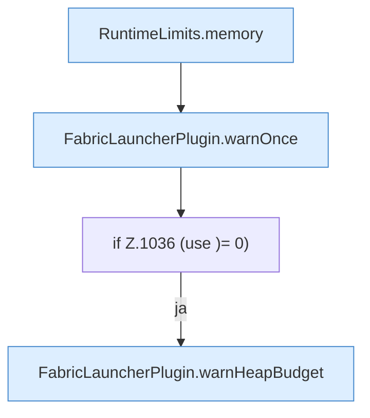

[[00 Start]] › [[Host-Betrieb]] › [[Speicher-Probe]] › [[FabricLauncherPlugin.sampleHostMemory]] › [[FabricLauncherPlugin.sampleHostMemory.Teil2]]

# FabricLauncherPlugin.sampleHostMemory.Teil2



```knoten
RuntimeLimits.memory
  Dieser Teil macht hier einen einzelnen Schritt. Eine Ebene tiefer steht er genauer. Betrifft den Speicher `memory`. Ruft `percent`.
FabricLauncherPlugin.warnOnce
  Schreibt eine Warnung nur ein einziges Mal, damit das Protokoll nicht vollläuft. Warnt `warnOnce`.
if Z.1036 (use )= 0)
  Zeile 1036: prüft `(use )= 0)`.
FabricLauncherPlugin.warnHeapBudget
  Das [[Glossar#Plugin|Plugin]] warnt vor den Programmspeicher die Grenze. Warnt `warnHeapBudget`. Ruft `parseMemoryBytes`, `notifyNtfy`.
```

> [!knoten]- Was die Blöcke tun
> - **RuntimeLimits.memory**: Dieser Teil macht hier einen einzelnen Schritt. Eine Ebene tiefer steht er genauer. Betrifft den Speicher `memory`. Ruft `percent`.
> - **FabricLauncherPlugin.warnOnce**: Schreibt eine Warnung nur ein einziges Mal, damit das Protokoll nicht vollläuft. Warnt `warnOnce`.
> - **if Z.1036 (use )= 0)**: Zeile 1036: prüft `(use )= 0)`.
> - **FabricLauncherPlugin.warnHeapBudget**: Das [[Glossar#Plugin|Plugin]] warnt vor den Programmspeicher die Grenze. Warnt `warnHeapBudget`. Ruft `parseMemoryBytes`, `notifyNtfy`.

- Ein weiterer Abschnitt derselben Übersicht.
- Fortsetzung von `FabricLauncherPlugin.sampleHostMemory`.
