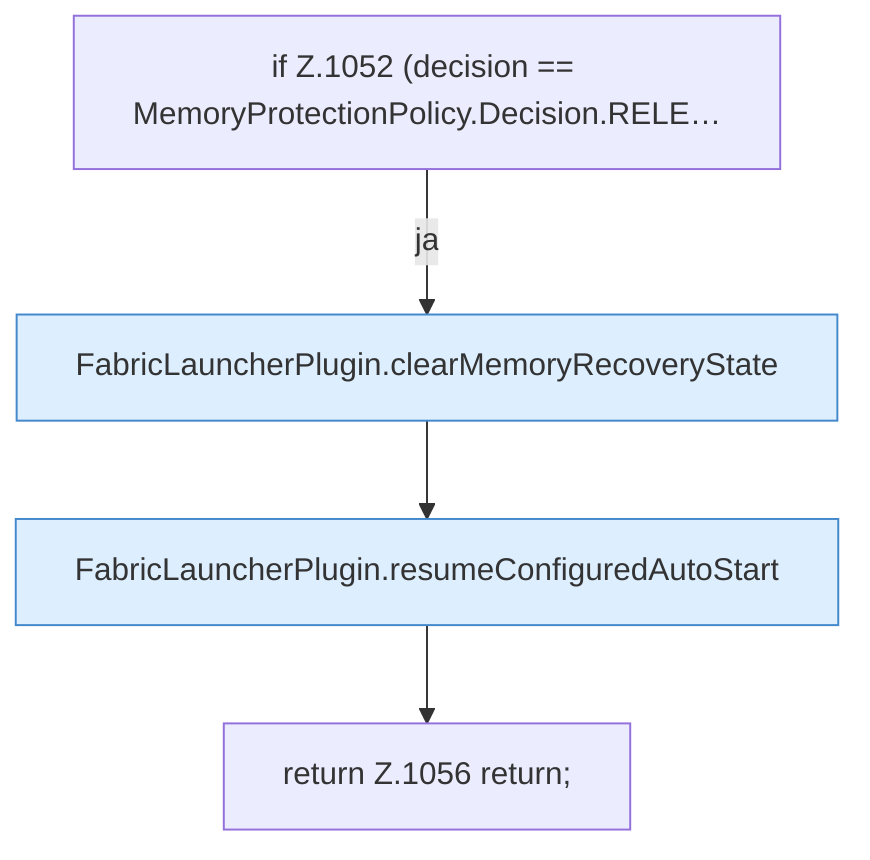

[[00 Start]] › [[Host-Betrieb]] › [[Speicher-Probe]] › [[FabricLauncherPlugin.sampleHostMemory]] › [[FabricLauncherPlugin.sampleHostMemory.Teil3.Z1052]]

# FabricLauncherPlugin.sampleHostMemory.Teil3.Z1052

- Fortsetzung von `FabricLauncherPlugin.sampleHostMemory.Teil3`, Quellreihenfolge.
