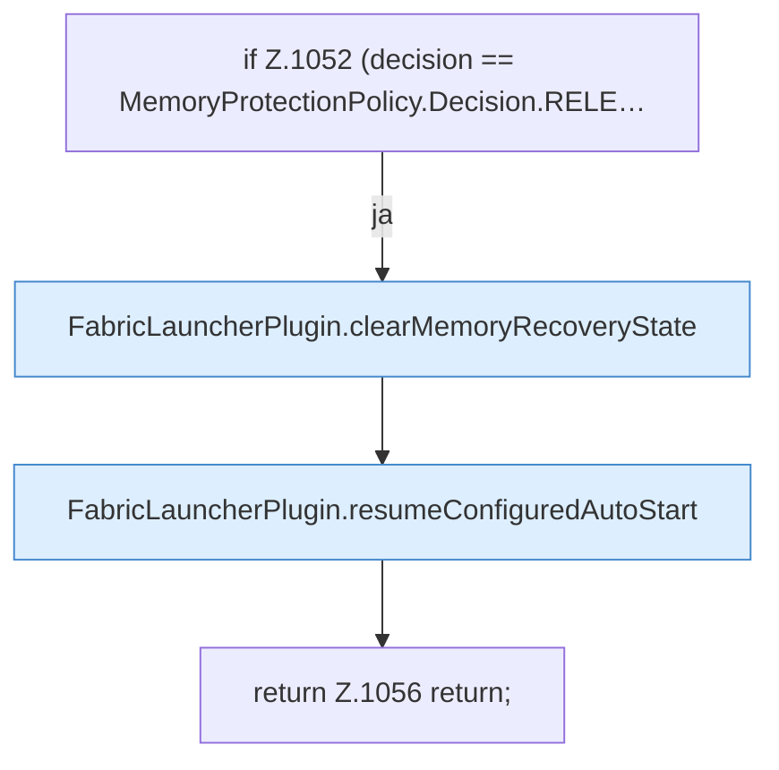

[[00 Start]] › [[Host-Betrieb]] › [[Speicher-Probe]] › [[FabricLauncherPlugin.sampleHostMemory]] › [[FabricLauncherPlugin.sampleHostMemory.Teil3.Z1052]]

# FabricLauncherPlugin.sampleHostMemory.Teil3.Z1052



```knoten
if Z.1052 (decision == MemoryProtectionPolicy.Decision.RELE…
  Zeile 1052: prüft `(decision == MemoryProtectionPolicy.Decision.RELE…`.
FabricLauncherPlugin.clearMemoryRecoveryState
  Das [[Glossar#Plugin|Plugin]] löscht den gemerkten Stand von den [[Glossar#Arbeitsspeicher|Arbeitsspeicher]] die Wiederherstellung den Zustand. Leert `clearMemoryRecoveryState`. Ruft `memoryRecoveryFile`, `finishRecovery`.
FabricLauncherPlugin.resumeConfiguredAutoStart
  Schaltet das automatische Starten wieder so ein, wie es in den [[Glossar#Einstellungen|Einstellungen]] steht. Setzt fort `resumeConfiguredAutoStart`. Ruft `notifyNtfy`, `startAsync`.
return Z.1056 return;
  Zeile 1056: Rückgabe `return;`.
```

> [!knoten]- Was die Blöcke tun
> - **if Z.1052 (decision == MemoryProtectionPolicy.Decision.RELE…**: Zeile 1052: prüft `(decision == MemoryProtectionPolicy.Decision.RELE…`.
> - **FabricLauncherPlugin.clearMemoryRecoveryState**: Das [[Glossar#Plugin|Plugin]] löscht den gemerkten Stand von den [[Glossar#Arbeitsspeicher|Arbeitsspeicher]] die Wiederherstellung den Zustand. Leert `clearMemoryRecoveryState`. Ruft `memoryRecoveryFile`, `finishRecovery`.
> - **FabricLauncherPlugin.resumeConfiguredAutoStart**: Schaltet das automatische Starten wieder so ein, wie es in den [[Glossar#Einstellungen|Einstellungen]] steht. Setzt fort `resumeConfiguredAutoStart`. Ruft `notifyNtfy`, `startAsync`.
> - **return Z.1056 return;**: Zeile 1056: Rückgabe `return;`.

- Der Ablauf geht in [[Glossar#Zeile|Zeile]] 1052 weiter. Eine Ebene tiefer steht er genauer.
- Fortsetzung von `FabricLauncherPlugin.sampleHostMemory.Teil3`.
