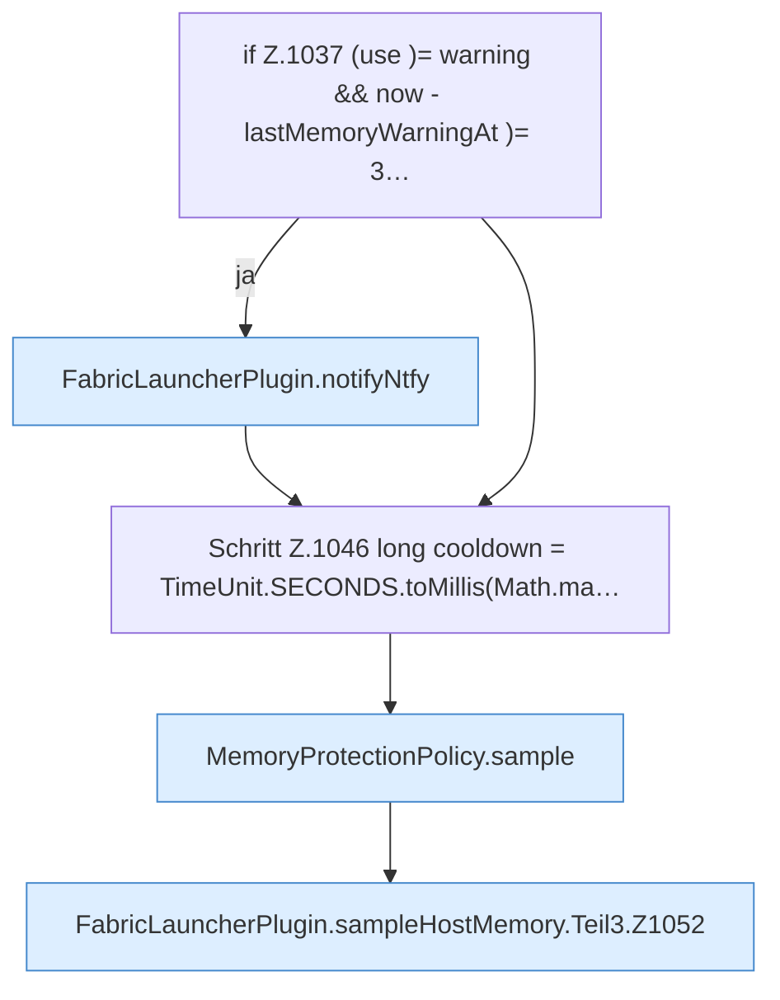

[[00 Start]] › [[Host-Betrieb]] › [[Speicher-Probe]] › [[FabricLauncherPlugin.sampleHostMemory]] › [[FabricLauncherPlugin.sampleHostMemory.Teil3]]

# FabricLauncherPlugin.sampleHostMemory.Teil3

- Fortsetzung von `FabricLauncherPlugin.sampleHostMemory`, Quellreihenfolge.
