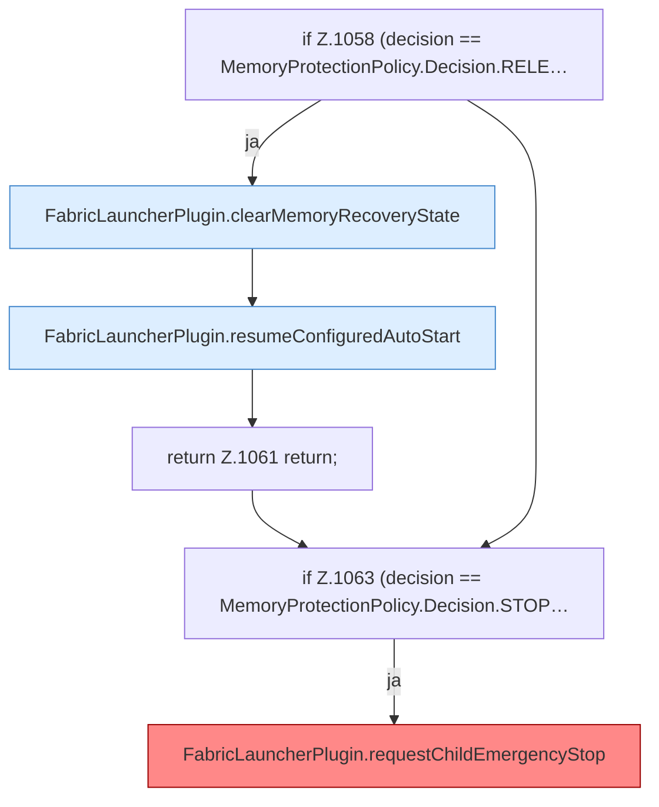

[[00 Start]] › [[Host-Betrieb]] › [[Speicher-Probe]] › [[FabricLauncherPlugin.sampleHostMemory]] › [[FabricLauncherPlugin.sampleHostMemory.Teil4]]

# FabricLauncherPlugin.sampleHostMemory.Teil4



```knoten
if Z.1058 (decision == MemoryProtectionPolicy.Decision.RELE…
  Zeile 1058: prüft `(decision == MemoryProtectionPolicy.Decision.RELE…`.
FabricLauncherPlugin.clearMemoryRecoveryState
  Das [[Glossar#Plugin|Plugin]] löscht den gemerkten Stand von den [[Glossar#Arbeitsspeicher|Arbeitsspeicher]] die Wiederherstellung den Zustand. Leert `clearMemoryRecoveryState`. Ruft `memoryRecoveryFile`, `finishRecovery`.
FabricLauncherPlugin.resumeConfiguredAutoStart
  Schaltet das automatische Starten wieder so ein, wie es in den [[Glossar#Einstellungen|Einstellungen]] steht. Setzt fort `resumeConfiguredAutoStart`. Ruft `notifyNtfy`, `startAsync`.
return Z.1061 return;
  Zeile 1061: Rückgabe `return;`.
if Z.1063 (decision == MemoryProtectionPolicy.Decision.STOP…
  Zeile 1063: prüft `(decision == MemoryProtectionPolicy.Decision.STOP…`.
FabricLauncherPlugin.requestChildEmergencyStop
  Schaltet den [[Glossar#Spielserver|Spielserver]] wegen Speichermangels aus. Die Meldung spricht von einem [[Glossar#Neustart|Neustart]], neu gestartet wird nicht. Stoppt den Child. Logtext sagt Emergency restart. [[Glossar#Befund|Befund]]: Kommentar widerspricht Code, sicher. Z.1175 Emergency restart warning, Z.1197–1199 wantRunning=false und stopBlocking, kein Start
```

> [!knoten]- Was die Blöcke tun
> - **if Z.1058 (decision == MemoryProtectionPolicy.Decision.RELE…**: Zeile 1058: prüft `(decision == MemoryProtectionPolicy.Decision.RELE…`.
> - **FabricLauncherPlugin.clearMemoryRecoveryState**: Das [[Glossar#Plugin|Plugin]] löscht den gemerkten Stand von den [[Glossar#Arbeitsspeicher|Arbeitsspeicher]] die Wiederherstellung den Zustand. Leert `clearMemoryRecoveryState`. Ruft `memoryRecoveryFile`, `finishRecovery`.
> - **FabricLauncherPlugin.resumeConfiguredAutoStart**: Schaltet das automatische Starten wieder so ein, wie es in den [[Glossar#Einstellungen|Einstellungen]] steht. Setzt fort `resumeConfiguredAutoStart`. Ruft `notifyNtfy`, `startAsync`.
> - **return Z.1061 return;**: Zeile 1061: Rückgabe `return;`.
> - **if Z.1063 (decision == MemoryProtectionPolicy.Decision.STOP…**: Zeile 1063: prüft `(decision == MemoryProtectionPolicy.Decision.STOP…`.
> - **FabricLauncherPlugin.requestChildEmergencyStop**: Schaltet den [[Glossar#Spielserver|Spielserver]] wegen Speichermangels aus. Die Meldung spricht von einem [[Glossar#Neustart|Neustart]], neu gestartet wird nicht. Stoppt den Child. Logtext sagt Emergency restart. [[Glossar#Befund|Befund]]: Kommentar widerspricht Code, sicher. Z.1175 Emergency restart warning, Z.1197–1199 wantRunning=false und stopBlocking, kein Start

- Ein weiterer Abschnitt derselben Übersicht.
- Fortsetzung von `FabricLauncherPlugin.sampleHostMemory`.
