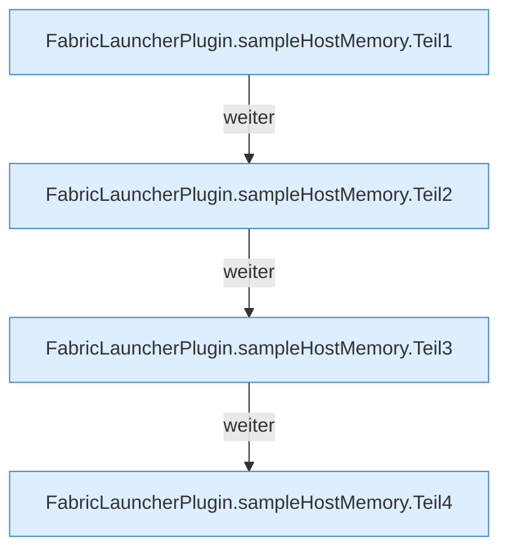
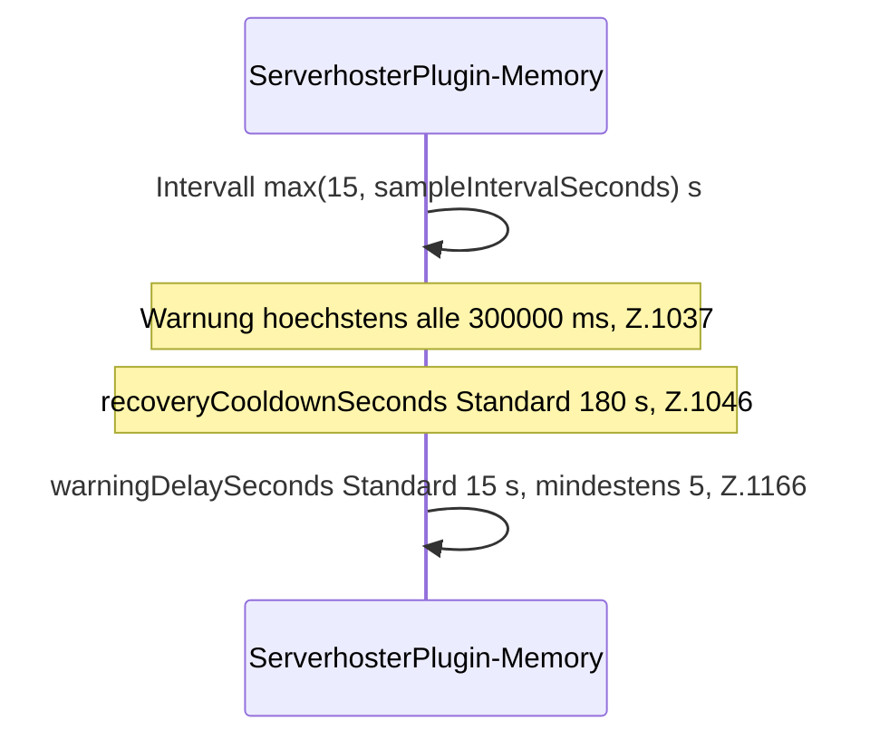

[[00 Start]] › [[Host-Betrieb]] › [[Speicher-Probe]] › [[FabricLauncherPlugin.sampleHostMemory]]

# FabricLauncherPlugin.sampleHostMemory

`FabricLauncherPlugin.sampleHostMemory()` [src/main/java/de/aichele/childlauncher/FabricLauncherPlugin.java:1005–1065](https://github.com/Sciddie/minecraft-serverhoster-plugin/blob/95b02b953b0b4c23673e900e021a7c3c844aa37d/src/main/java/de/aichele/childlauncher/FabricLauncherPlugin.java#L1005-L1065)



```knoten
FabricLauncherPlugin.sampleHostMemory.Teil1
  Abschnitt 1 dieses Ablaufs, in Quellreihenfolge.
FabricLauncherPlugin.sampleHostMemory.Teil2
  Abschnitt 2 dieses Ablaufs, in Quellreihenfolge.
FabricLauncherPlugin.sampleHostMemory.Teil3
  Abschnitt 3 dieses Ablaufs, in Quellreihenfolge.
FabricLauncherPlugin.sampleHostMemory.Teil4
  Abschnitt 4 dieses Ablaufs, in Quellreihenfolge.
```



- Ein Sample auf `ServerhosterPlugin-Memory`.
- Befund: Altlast, sicher. Z.1030–1031 liest memoryProtection.autoShutdown als Fallback
