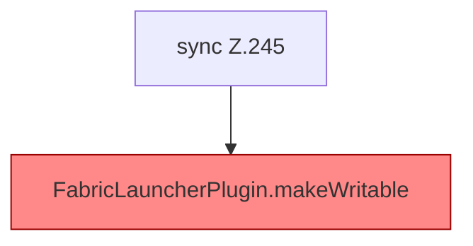

[[00 Start]] › [[Plugin-Kern]] › [[Lebenszyklus]] › [[FabricLauncherPlugin.saveConfigWritable]]

# FabricLauncherPlugin.saveConfigWritable

`FabricLauncherPlugin.saveConfigWritable()` [src/main/java/de/aichele/childlauncher/FabricLauncherPlugin.java:245–250](https://github.com/Sciddie/minecraft-serverhoster-plugin/blob/95b02b953b0b4c23673e900e021a7c3c844aa37d/src/main/java/de/aichele/childlauncher/FabricLauncherPlugin.java#L245-L250)



```knoten
sync Z.245
  Hier wartet die [[Glossar#Funktion|Funktion]], damit nicht zwei Arbeitsstränge denselben Schritt gleichzeitig machen. Das steht in [[Glossar#Zeile|Zeile]] 245.
FabricLauncherPlugin.makeWritable
  Setzt die [[Glossar#Dateirechte|Dateirechte]] eines Ordners oder einer Datei sehr offen, damit der [[Glossar#Spielserver|Spielserver]] dort schreiben kann. Im [[Glossar#Quelltext|Quelltext]] heißt das `makeWritable`. Auffällig: das kann sich anders verhalten, als man erwartet. Das nennt man [[Glossar#Unerwartetes Verhalten|Unerwartetes Verhalten]].
```

> [!knoten]- Was die Blöcke tun
> - **sync Z.245**: Hier wartet die [[Glossar#Funktion|Funktion]], damit nicht zwei Arbeitsstränge denselben Schritt gleichzeitig machen. Das steht in [[Glossar#Zeile|Zeile]] 245.
> - **FabricLauncherPlugin.makeWritable**: Setzt die [[Glossar#Dateirechte|Dateirechte]] eines Ordners oder einer Datei sehr offen, damit der [[Glossar#Spielserver|Spielserver]] dort schreiben kann. Im [[Glossar#Quelltext|Quelltext]] heißt das `makeWritable`. Auffällig: das kann sich anders verhalten, als man erwartet. Das nennt man [[Glossar#Unerwartetes Verhalten|Unerwartetes Verhalten]].

- Speichert die [[Glossar#Einstellungsdatei|Einstellungsdatei]] und setzt danach die [[Glossar#Dateirechte|Dateirechte]] so, dass sie beschreibbar bleibt.
