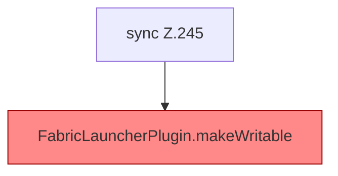

[[00 Start]] › [[Plugin-Kern]] › [[Lebenszyklus]] › [[FabricLauncherPlugin.saveConfigWritable]]

# FabricLauncherPlugin.saveConfigWritable

`FabricLauncherPlugin.saveConfigWritable()` [src/main/java/de/aichele/childlauncher/FabricLauncherPlugin.java:245–250](https://github.com/Sciddie/minecraft-serverhoster-plugin/blob/95b02b953b0b4c23673e900e021a7c3c844aa37d/src/main/java/de/aichele/childlauncher/FabricLauncherPlugin.java#L245-L250)

- `saveConfigWritable` in `src/main/java/de/aichele/childlauncher/FabricLauncherPlugin.java`
