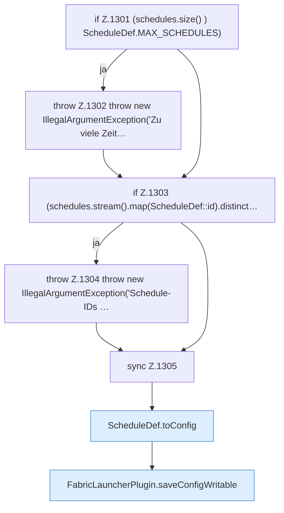

[[00 Start]] › [[Zeitplaene]] › [[Schedules]] › [[FabricLauncherPlugin.saveSchedules]]

# FabricLauncherPlugin.saveSchedules

`FabricLauncherPlugin.saveSchedules(List<ScheduleDef> schedules)` [src/main/java/de/aichele/childlauncher/FabricLauncherPlugin.java:1300–1309](https://github.com/Sciddie/minecraft-serverhoster-plugin/blob/95b02b953b0b4c23673e900e021a7c3c844aa37d/src/main/java/de/aichele/childlauncher/FabricLauncherPlugin.java#L1300-L1309)



```knoten
if Z.1301 (schedules.size() ) ScheduleDef.MAX_SCHEDULES)
  Hier fällt eine Entscheidung. Nur wenn sie zutrifft, geht es den Ja-Weg weiter. Das steht in [[Glossar#Zeile|Zeile]] 1301.
throw Z.1302 throw new IllegalArgumentException('Zu viele Zeit…
  Hier bricht die [[Glossar#Funktion|Funktion]] ab, weil etwas nicht geklappt hat. Das steht in [[Glossar#Zeile|Zeile]] 1302.
if Z.1303 (schedules.stream().map(ScheduleDef::id).distinct…
  Hier fällt eine Entscheidung. Nur wenn sie zutrifft, geht es den Ja-Weg weiter. Das steht in [[Glossar#Zeile|Zeile]] 1303.
throw Z.1304 throw new IllegalArgumentException('Schedule-IDs …
  Hier bricht die [[Glossar#Funktion|Funktion]] ab, weil etwas nicht geklappt hat. Das steht in [[Glossar#Zeile|Zeile]] 1304.
sync Z.1305
  Hier wartet die [[Glossar#Funktion|Funktion]], damit nicht zwei Arbeitsstränge denselben Schritt gleichzeitig machen. Das steht in [[Glossar#Zeile|Zeile]] 1305.
ScheduleDef.toConfig
  Der [[Glossar#Zeitplan|Zeitplan]] kümmert sich um die [[Glossar#Einstellungen|Einstellungen]]. Im [[Glossar#Quelltext|Quelltext]] heißt das `toConfig`.
FabricLauncherPlugin.saveConfigWritable
  Speichert die [[Glossar#Einstellungsdatei|Einstellungsdatei]] und setzt danach die [[Glossar#Dateirechte|Dateirechte]] so, dass sie beschreibbar bleibt. Im [[Glossar#Quelltext|Quelltext]] heißt das `saveConfigWritable`.
```

> [!knoten]- Was die Blöcke tun
> - **if Z.1301 (schedules.size() ) ScheduleDef.MAX_SCHEDULES)**: Hier fällt eine Entscheidung. Nur wenn sie zutrifft, geht es den Ja-Weg weiter. Das steht in [[Glossar#Zeile|Zeile]] 1301.
> - **throw Z.1302 throw new IllegalArgumentException('Zu viele Zeit…**: Hier bricht die [[Glossar#Funktion|Funktion]] ab, weil etwas nicht geklappt hat. Das steht in [[Glossar#Zeile|Zeile]] 1302.
> - **if Z.1303 (schedules.stream().map(ScheduleDef::id).distinct…**: Hier fällt eine Entscheidung. Nur wenn sie zutrifft, geht es den Ja-Weg weiter. Das steht in [[Glossar#Zeile|Zeile]] 1303.
> - **throw Z.1304 throw new IllegalArgumentException('Schedule-IDs …**: Hier bricht die [[Glossar#Funktion|Funktion]] ab, weil etwas nicht geklappt hat. Das steht in [[Glossar#Zeile|Zeile]] 1304.
> - **sync Z.1305**: Hier wartet die [[Glossar#Funktion|Funktion]], damit nicht zwei Arbeitsstränge denselben Schritt gleichzeitig machen. Das steht in [[Glossar#Zeile|Zeile]] 1305.
> - **ScheduleDef.toConfig**: Der [[Glossar#Zeitplan|Zeitplan]] kümmert sich um die [[Glossar#Einstellungen|Einstellungen]]. Im [[Glossar#Quelltext|Quelltext]] heißt das `toConfig`.
> - **FabricLauncherPlugin.saveConfigWritable**: Speichert die [[Glossar#Einstellungsdatei|Einstellungsdatei]] und setzt danach die [[Glossar#Dateirechte|Dateirechte]] so, dass sie beschreibbar bleibt. Im [[Glossar#Quelltext|Quelltext]] heißt das `saveConfigWritable`.

- Das [[Glossar#Plugin|Plugin]] speichert die Zeitpläne.
