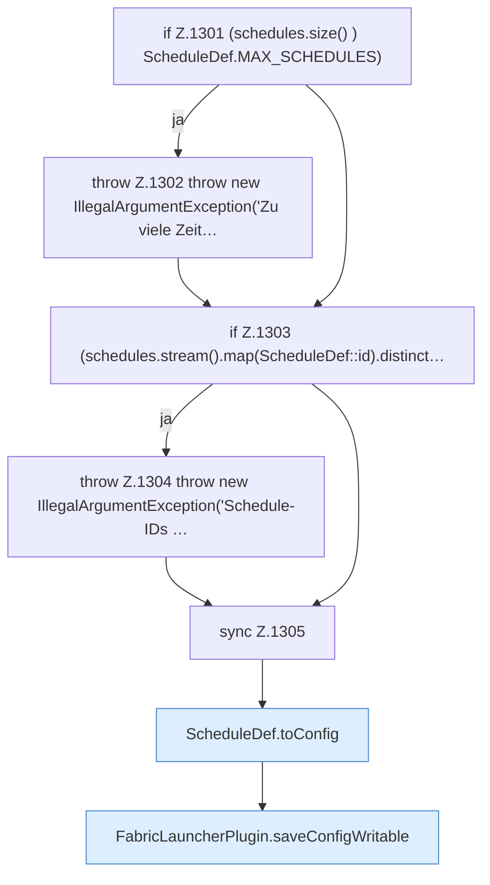

[[00 Start]] › [[Zeitplaene]] › [[Schedules]] › [[FabricLauncherPlugin.saveSchedules]]

# FabricLauncherPlugin.saveSchedules

`FabricLauncherPlugin.saveSchedules(List<ScheduleDef> schedules)` [src/main/java/de/aichele/childlauncher/FabricLauncherPlugin.java:1300–1309](https://github.com/Sciddie/minecraft-serverhoster-plugin/blob/95b02b953b0b4c23673e900e021a7c3c844aa37d/src/main/java/de/aichele/childlauncher/FabricLauncherPlugin.java#L1300-L1309)

- `saveSchedules` in `src/main/java/de/aichele/childlauncher/FabricLauncherPlugin.java`
