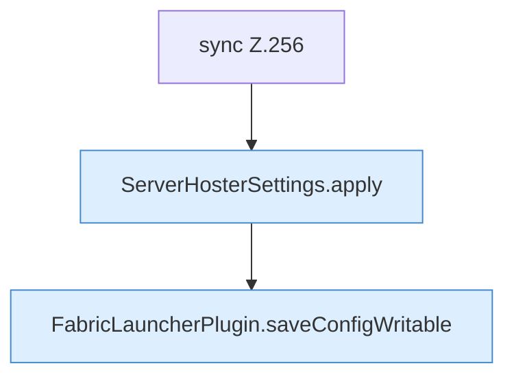

[[00 Start]] › [[Plugin-Kern]] › [[Konfiguration]] › [[FabricLauncherPlugin.saveSettings]]

# FabricLauncherPlugin.saveSettings

`FabricLauncherPlugin.saveSettings(ServerHosterSettings settings)` [src/main/java/de/aichele/childlauncher/FabricLauncherPlugin.java:256–261](https://github.com/Sciddie/minecraft-serverhoster-plugin/blob/95b02b953b0b4c23673e900e021a7c3c844aa37d/src/main/java/de/aichele/childlauncher/FabricLauncherPlugin.java#L256-L261)



```knoten
sync Z.256
  Hier wartet die [[Glossar#Funktion|Funktion]], damit nicht zwei Arbeitsstränge denselben Schritt gleichzeitig machen. Das steht in [[Glossar#Zeile|Zeile]] 256.
ServerHosterSettings.apply
  Dieser Teil wendet an das. Im [[Glossar#Quelltext|Quelltext]] heißt das `apply`.
FabricLauncherPlugin.saveConfigWritable
  Speichert die [[Glossar#Einstellungsdatei|Einstellungsdatei]] und setzt danach die [[Glossar#Dateirechte|Dateirechte]] so, dass sie beschreibbar bleibt. Im [[Glossar#Quelltext|Quelltext]] heißt das `saveConfigWritable`.
```

> [!knoten]- Was die Blöcke tun
> - **sync Z.256**: Hier wartet die [[Glossar#Funktion|Funktion]], damit nicht zwei Arbeitsstränge denselben Schritt gleichzeitig machen. Das steht in [[Glossar#Zeile|Zeile]] 256.
> - **ServerHosterSettings.apply**: Dieser Teil wendet an das. Im [[Glossar#Quelltext|Quelltext]] heißt das `apply`.
> - **FabricLauncherPlugin.saveConfigWritable**: Speichert die [[Glossar#Einstellungsdatei|Einstellungsdatei]] und setzt danach die [[Glossar#Dateirechte|Dateirechte]] so, dass sie beschreibbar bleibt. Im [[Glossar#Quelltext|Quelltext]] heißt das `saveConfigWritable`.

- Das [[Glossar#Plugin|Plugin]] speichert die [[Glossar#Einstellungen|Einstellungen]].
