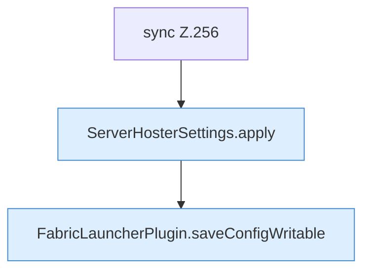

[[00 Start]] › [[Plugin-Kern]] › [[Konfiguration]] › [[FabricLauncherPlugin.saveSettings]]

# FabricLauncherPlugin.saveSettings

`FabricLauncherPlugin.saveSettings(ServerHosterSettings settings)` [src/main/java/de/aichele/childlauncher/FabricLauncherPlugin.java:256–261](https://github.com/Sciddie/minecraft-serverhoster-plugin/blob/95b02b953b0b4c23673e900e021a7c3c844aa37d/src/main/java/de/aichele/childlauncher/FabricLauncherPlugin.java#L256-L261)



```knoten
sync Z.256
  Zeile 256: synchronisierter Block.
ServerHosterSettings.apply
  Wendet an `apply`.
FabricLauncherPlugin.saveConfigWritable
  Speichert `saveConfigWritable`. Ruft `makeWritable`.
```

- `saveSettings` in `src/main/java/de/aichele/childlauncher/FabricLauncherPlugin.java`
