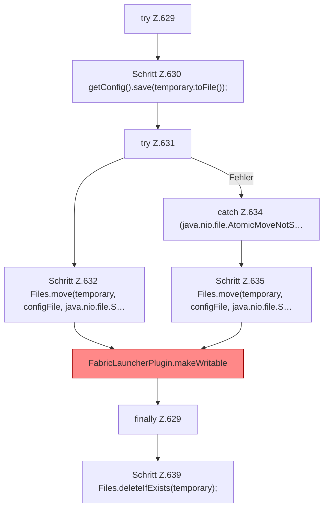

[[00 Start]] › [[Plugin-Kern]] › [[Setup]] › [[Setup-Dialog]] › [[FabricLauncherPlugin.saveSetupConfigAtomically]] › [[FabricLauncherPlugin.saveSetupConfigAtomically.Z629]]

# FabricLauncherPlugin.saveSetupConfigAtomically.Z629

- Fortsetzung von `FabricLauncherPlugin.saveSetupConfigAtomically`, Quellreihenfolge.
