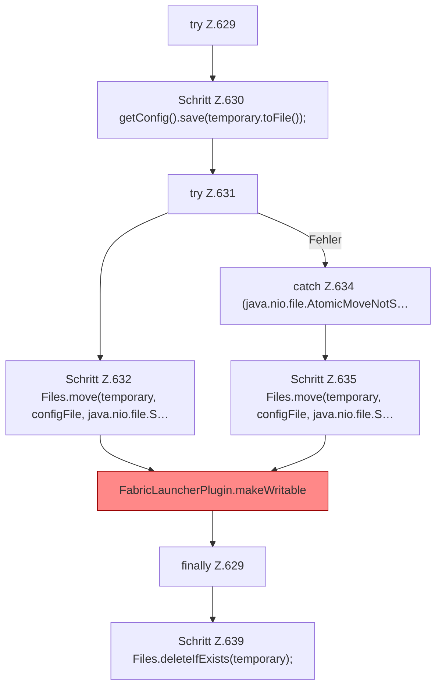

[[00 Start]] › [[Plugin-Kern]] › [[Setup]] › [[Setup-Dialog]] › [[FabricLauncherPlugin.saveSetupConfigAtomically]] › [[FabricLauncherPlugin.saveSetupConfigAtomically.Z629]]

# FabricLauncherPlugin.saveSetupConfigAtomically.Z629



```knoten
try Z.629
  Zeile 629: Versuch. Der Fehlerpfad geht in catch.
Schritt Z.630 getConfig().save(temporary.toFile());
  Zeile 630: liest die Config. `getConfig().save(temporary.toFile());`
try Z.631
  Zeile 631: Versuch. Der Fehlerpfad geht in catch.
Schritt Z.632 Files.move(temporary, configFile, java.nio.file.S…
  Zeile 632: Dateioperation. `Files.move(temporary, configFile, java.nio.file.S…`
catch Z.634 (java.nio.file.AtomicMoveNotS…
  Zeile 634: fängt (java.nio.file.AtomicMoveNotS….
Schritt Z.635 Files.move(temporary, configFile, java.nio.file.S…
  Zeile 635: Dateioperation. `Files.move(temporary, configFile, java.nio.file.S…`
FabricLauncherPlugin.makeWritable
  Setzt die [[Glossar#Dateirechte|Dateirechte]] eines Ordners oder einer Datei sehr offen, damit der [[Glossar#Spielserver|Spielserver]] dort schreiben kann. Setzt POSIX `rwxrwxrwx` für Ordner und `rw-rw-rw-` für Dateien. [[Glossar#Befund|Befund]]: Logikrisiko, sicher. FabricLauncherPlugin.java:241–242 rwxrwxrwx und rw-rw-rw-. Kommentar Z.240 sagt rw für group/other
finally Z.629
  Läuft danach immer, auch nach einem Fehler.
Schritt Z.639 Files.deleteIfExists(temporary);
  Zeile 639: Dateioperation. `Files.deleteIfExists(temporary);`
```

> [!knoten]- Was die Blöcke tun
> - **try Z.629**: Zeile 629: Versuch. Der Fehlerpfad geht in catch.
> - **Schritt Z.630 getConfig().save(temporary.toFile());**: Zeile 630: liest die Config. `getConfig().save(temporary.toFile());`
> - **try Z.631**: Zeile 631: Versuch. Der Fehlerpfad geht in catch.
> - **Schritt Z.632 Files.move(temporary, configFile, java.nio.file.S…**: Zeile 632: Dateioperation. `Files.move(temporary, configFile, java.nio.file.S…`
> - **catch Z.634 (java.nio.file.AtomicMoveNotS…**: Zeile 634: fängt (java.nio.file.AtomicMoveNotS….
> - **Schritt Z.635 Files.move(temporary, configFile, java.nio.file.S…**: Zeile 635: Dateioperation. `Files.move(temporary, configFile, java.nio.file.S…`
> - **FabricLauncherPlugin.makeWritable**: Setzt die [[Glossar#Dateirechte|Dateirechte]] eines Ordners oder einer Datei sehr offen, damit der [[Glossar#Spielserver|Spielserver]] dort schreiben kann. Setzt POSIX `rwxrwxrwx` für Ordner und `rw-rw-rw-` für Dateien. [[Glossar#Befund|Befund]]: Logikrisiko, sicher. FabricLauncherPlugin.java:241–242 rwxrwxrwx und rw-rw-rw-. Kommentar Z.240 sagt rw für group/other
> - **finally Z.629**: Läuft danach immer, auch nach einem Fehler.
> - **Schritt Z.639 Files.deleteIfExists(temporary);**: Zeile 639: Dateioperation. `Files.deleteIfExists(temporary);`

- Der Ablauf geht in [[Glossar#Zeile|Zeile]] 629 weiter. Eine Ebene tiefer steht er genauer.
- Fortsetzung von `FabricLauncherPlugin.saveSetupConfigAtomically`.
