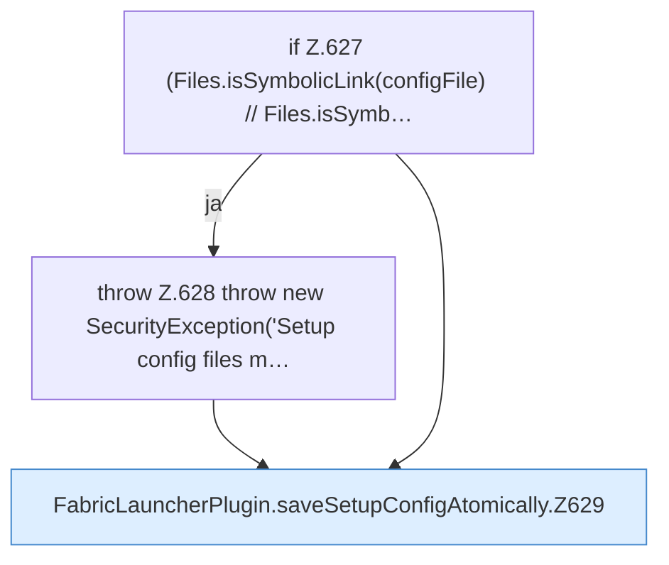

[[00 Start]] › [[Plugin-Kern]] › [[Setup]] › [[Setup-Dialog]] › [[FabricLauncherPlugin.saveSetupConfigAtomically]]

# FabricLauncherPlugin.saveSetupConfigAtomically

`FabricLauncherPlugin.saveSetupConfigAtomically()` [src/main/java/de/aichele/childlauncher/FabricLauncherPlugin.java:624–641](https://github.com/Sciddie/minecraft-serverhoster-plugin/blob/95b02b953b0b4c23673e900e021a7c3c844aa37d/src/main/java/de/aichele/childlauncher/FabricLauncherPlugin.java#L624-L641)



```knoten
if Z.627 (Files.isSymbolicLink(configFile) // Files.isSymb…
  Zeile 627: prüft `(Files.isSymbolicLink(configFile) // Files.isSymb…`.
throw Z.628 throw new SecurityException('Setup config files m…
  Zeile 628: Abbruch `throw new SecurityException('Setup config files m…`.
FabricLauncherPlugin.saveSetupConfigAtomically.Z629
  Der Ablauf geht in [[Glossar#Zeile|Zeile]] 629 weiter. Eine Ebene tiefer steht er genauer. Fortsetzung des Ablaufs ab Zeile 629.
```

> [!knoten]- Was die Blöcke tun
> - **if Z.627 (Files.isSymbolicLink(configFile) // Files.isSymb…**: Zeile 627: prüft `(Files.isSymbolicLink(configFile) // Files.isSymb…`.
> - **throw Z.628 throw new SecurityException('Setup config files m…**: Zeile 628: Abbruch `throw new SecurityException('Setup config files m…`.
> - **FabricLauncherPlugin.saveSetupConfigAtomically.Z629**: Der Ablauf geht in [[Glossar#Zeile|Zeile]] 629 weiter. Eine Ebene tiefer steht er genauer. Fortsetzung des Ablaufs ab Zeile 629.

- Das [[Glossar#Plugin|Plugin]] speichert die [[Glossar#Einrichtung|Einrichtung]] die [[Glossar#Einstellungen|Einstellungen]].
- `saveSetupConfigAtomically` in `src/main/java/de/aichele/childlauncher/FabricLauncherPlugin.java`
