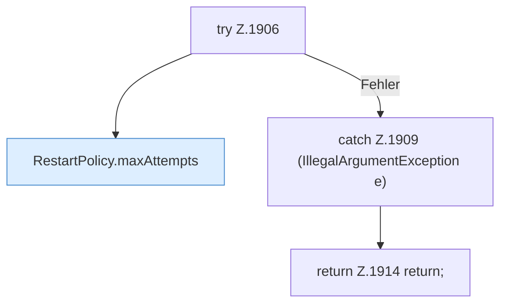

[[00 Start]] › [[Child-Prozess]] › [[Neustart]] › [[FabricLauncherPlugin.scheduleRestart]] › [[FabricLauncherPlugin.scheduleRestart.Teil1.Z1906]]

# FabricLauncherPlugin.scheduleRestart.Teil1.Z1906

- Fortsetzung von `FabricLauncherPlugin.scheduleRestart.Teil1`, Quellreihenfolge.
