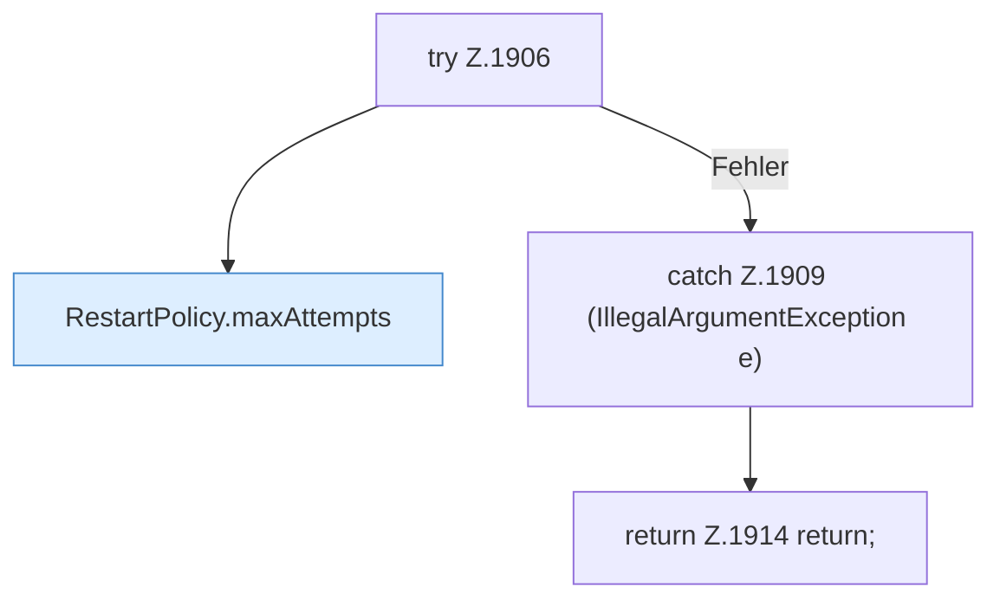

[[00 Start]] › [[Child-Prozess]] › [[Neustart]] › [[FabricLauncherPlugin.scheduleRestart]] › [[FabricLauncherPlugin.scheduleRestart.Teil1.Z1906]]

# FabricLauncherPlugin.scheduleRestart.Teil1.Z1906



```knoten
try Z.1906
  Zeile 1906: Versuch. Der Fehlerpfad geht in catch.
RestartPolicy.maxAttempts
  Begrenzt nach oben `maxAttempts`.
catch Z.1909 (IllegalArgumentException e)
  Zeile 1909: fängt (IllegalArgumentException e).
return Z.1914 return;
  Zeile 1914: Rückgabe `return;`.
```

- Fortsetzung von `FabricLauncherPlugin.scheduleRestart.Teil1`, Quellreihenfolge.
