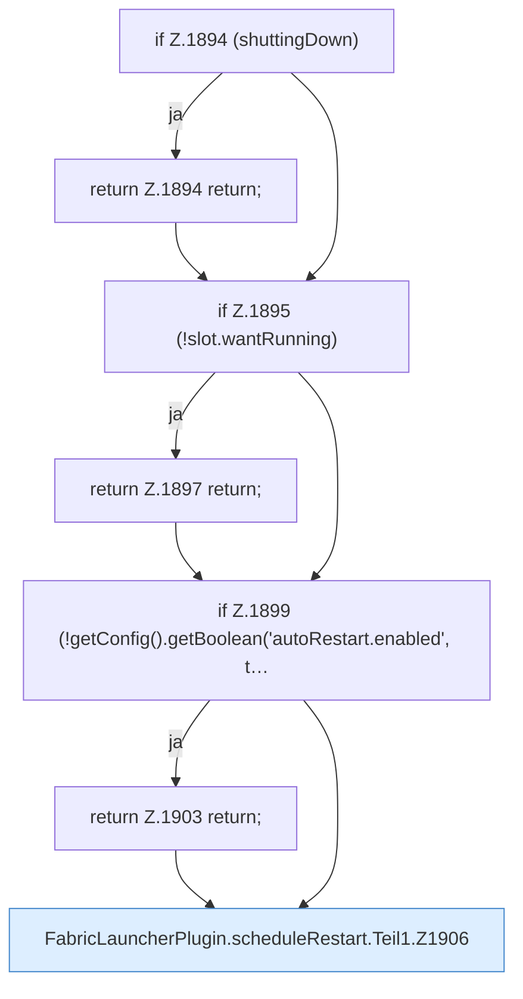

[[00 Start]] › [[Child-Prozess]] › [[Neustart]] › [[FabricLauncherPlugin.scheduleRestart]] › [[FabricLauncherPlugin.scheduleRestart.Teil1]]

# FabricLauncherPlugin.scheduleRestart.Teil1

- Fortsetzung von `FabricLauncherPlugin.scheduleRestart`, Quellreihenfolge.
