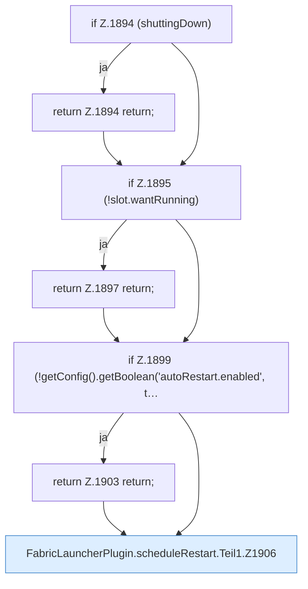

[[00 Start]] › [[Child-Prozess]] › [[Neustart]] › [[FabricLauncherPlugin.scheduleRestart]] › [[FabricLauncherPlugin.scheduleRestart.Teil1]]

# FabricLauncherPlugin.scheduleRestart.Teil1



```knoten
if Z.1894 (shuttingDown)
  Zeile 1894: prüft `(shuttingDown)`.
return Z.1894 return;
  Zeile 1894: Rückgabe `return;`.
if Z.1895 (!slot.wantRunning)
  Zeile 1895: prüft `(!slot.wantRunning)`.
return Z.1897 return;
  Zeile 1897: Rückgabe `return;`.
if Z.1899 (!getConfig().getBoolean('autoRestart.enabled', t…
  Zeile 1899: prüft `(!getConfig().getBoolean('autoRestart.enabled', t…`.
return Z.1903 return;
  Zeile 1903: Rückgabe `return;`.
FabricLauncherPlugin.scheduleRestart.Teil1.Z1906
  Der Ablauf geht in [[Glossar#Zeile|Zeile]] 1906 weiter. Eine Ebene tiefer steht er genauer. Fortsetzung des Ablaufs ab Zeile 1906.
```

> [!knoten]- Was die Blöcke tun
> - **if Z.1894 (shuttingDown)**: Zeile 1894: prüft `(shuttingDown)`.
> - **return Z.1894 return;**: Zeile 1894: Rückgabe `return;`.
> - **if Z.1895 (!slot.wantRunning)**: Zeile 1895: prüft `(!slot.wantRunning)`.
> - **return Z.1897 return;**: Zeile 1897: Rückgabe `return;`.
> - **if Z.1899 (!getConfig().getBoolean('autoRestart.enabled', t…**: Zeile 1899: prüft `(!getConfig().getBoolean('autoRestart.enabled', t…`.
> - **return Z.1903 return;**: Zeile 1903: Rückgabe `return;`.
> - **FabricLauncherPlugin.scheduleRestart.Teil1.Z1906**: Der Ablauf geht in [[Glossar#Zeile|Zeile]] 1906 weiter. Eine Ebene tiefer steht er genauer. Fortsetzung des Ablaufs ab Zeile 1906.

- Ein weiterer Abschnitt derselben Übersicht.
- Fortsetzung von `FabricLauncherPlugin.scheduleRestart`.
