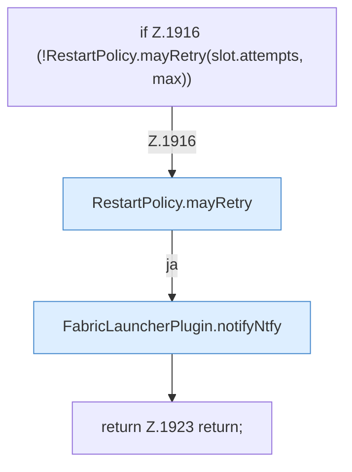

[[00 Start]] › [[Child-Prozess]] › [[Neustart]] › [[FabricLauncherPlugin.scheduleRestart]] › [[FabricLauncherPlugin.scheduleRestart.Teil2.Z1916]]

# FabricLauncherPlugin.scheduleRestart.Teil2.Z1916

- Fortsetzung von `FabricLauncherPlugin.scheduleRestart.Teil2`, Quellreihenfolge.
