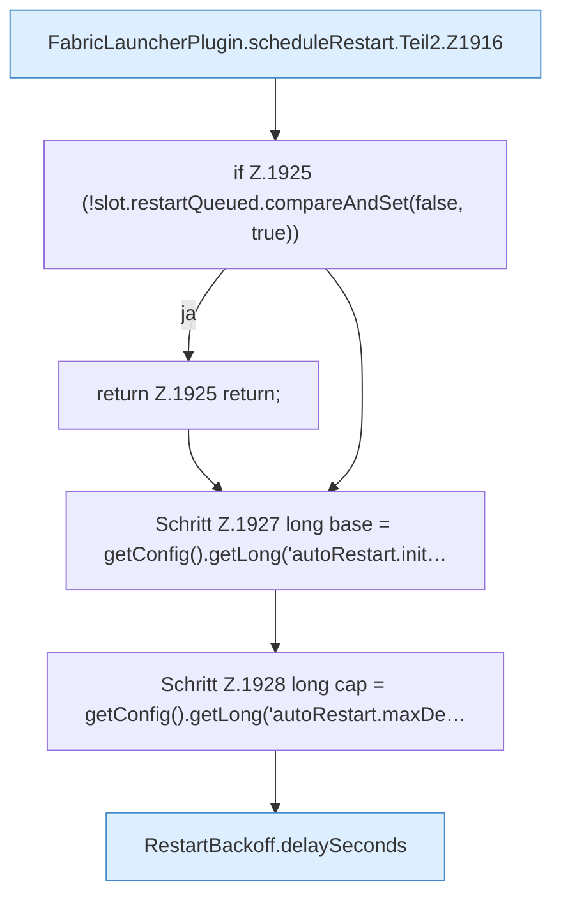

[[00 Start]] › [[Child-Prozess]] › [[Neustart]] › [[FabricLauncherPlugin.scheduleRestart]] › [[FabricLauncherPlugin.scheduleRestart.Teil2]]

# FabricLauncherPlugin.scheduleRestart.Teil2



```knoten
FabricLauncherPlugin.scheduleRestart.Teil2.Z1916
  Der Ablauf geht in [[Glossar#Zeile|Zeile]] 1916 weiter. Eine Ebene tiefer steht er genauer. Fortsetzung des Ablaufs ab Zeile 1916.
if Z.1925 (!slot.restartQueued.compareAndSet(false, true))
  Zeile 1925: prüft `(!slot.restartQueued.compareAndSet(false, true))`.
return Z.1925 return;
  Zeile 1925: Rückgabe `return;`.
Schritt Z.1927 long base = getConfig().getLong('autoRestart.init…
  Zeile 1927: liest die Config. `long base = getConfig().getLong('autoRestart.init…`
Schritt Z.1928 long cap = getConfig().getLong('autoRestart.maxDe…
  Zeile 1928: liest die Config. `long cap = getConfig().getLong('autoRestart.maxDe…`
RestartBackoff.delaySeconds
  Dieser Teil macht hier einen einzelnen Schritt. Eine Ebene tiefer steht er genauer. Rechnet die Wartezeit `delaySeconds`.
```

> [!knoten]- Was die Blöcke tun
> - **FabricLauncherPlugin.scheduleRestart.Teil2.Z1916**: Der Ablauf geht in [[Glossar#Zeile|Zeile]] 1916 weiter. Eine Ebene tiefer steht er genauer. Fortsetzung des Ablaufs ab Zeile 1916.
> - **if Z.1925 (!slot.restartQueued.compareAndSet(false, true))**: Zeile 1925: prüft `(!slot.restartQueued.compareAndSet(false, true))`.
> - **return Z.1925 return;**: Zeile 1925: Rückgabe `return;`.
> - **Schritt Z.1927 long base = getConfig().getLong('autoRestart.init…**: Zeile 1927: liest die Config. `long base = getConfig().getLong('autoRestart.init…`
> - **Schritt Z.1928 long cap = getConfig().getLong('autoRestart.maxDe…**: Zeile 1928: liest die Config. `long cap = getConfig().getLong('autoRestart.maxDe…`
> - **RestartBackoff.delaySeconds**: Dieser Teil macht hier einen einzelnen Schritt. Eine Ebene tiefer steht er genauer. Rechnet die Wartezeit `delaySeconds`.

- Ein weiterer Abschnitt derselben Übersicht.
- Fortsetzung von `FabricLauncherPlugin.scheduleRestart`.
