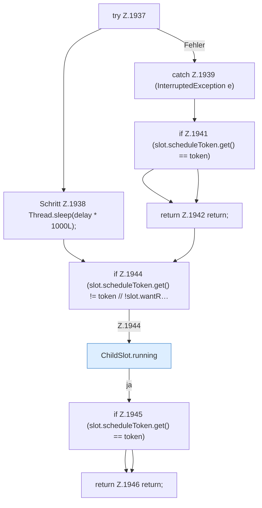

[[00 Start]] › [[Child-Prozess]] › [[Neustart]] › [[FabricLauncherPlugin.scheduleRestart]] › [[FabricLauncherPlugin.scheduleRestart.Teil3.Z1934.Z1935.Teil1]]

# FabricLauncherPlugin.scheduleRestart.Teil3.Z1934.Z1935.Teil1



```knoten
try Z.1937
  Zeile 1937: Versuch. Der Fehlerpfad geht in catch.
Schritt Z.1938 Thread.sleep(delay * 1000L);
  Zeile 1938: wartet. `Thread.sleep(delay * 1000L);`
catch Z.1939 (InterruptedException e)
  Zeile 1939: fängt (InterruptedException e).
if Z.1941 (slot.scheduleToken.get() == token)
  Zeile 1941: prüft `(slot.scheduleToken.get() == token)`.
return Z.1942 return;
  Zeile 1942: Rückgabe `return;`.
if Z.1944 (slot.scheduleToken.get() != token // !slot.wantR…
  Zeile 1944: prüft `(slot.scheduleToken.get() != token // !slot.wantR…`.
ChildSlot.running
  Sagt, ob der Prozess läuft `running`.
if Z.1945 (slot.scheduleToken.get() == token)
  Zeile 1945: prüft `(slot.scheduleToken.get() == token)`.
return Z.1946 return;
  Zeile 1946: Rückgabe `return;`.
```

- Fortsetzung von `FabricLauncherPlugin.scheduleRestart.Teil3.Z1934.Z1935`, Quellreihenfolge.
