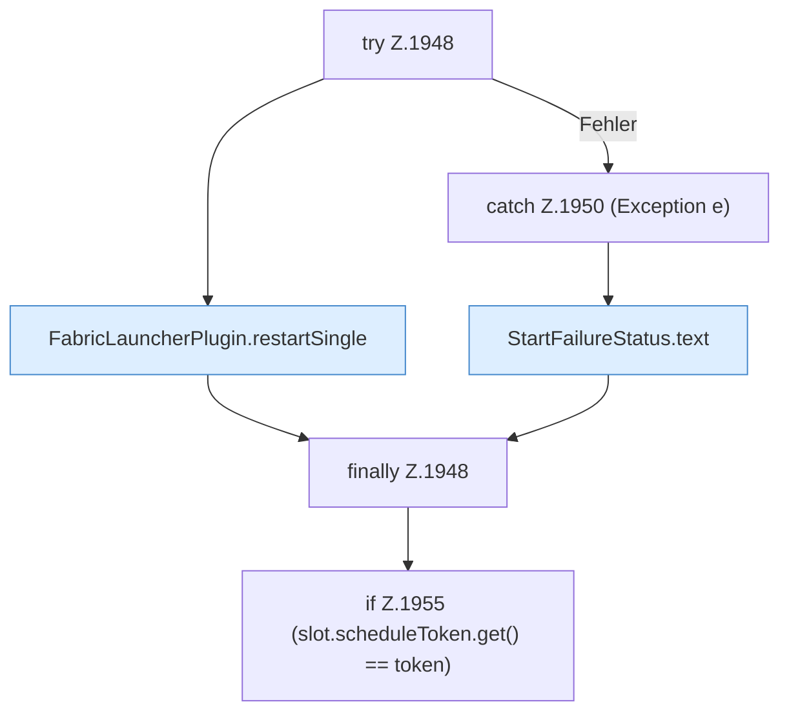

[[00 Start]] › [[Child-Prozess]] › [[Neustart]] › [[FabricLauncherPlugin.scheduleRestart]] › [[FabricLauncherPlugin.scheduleRestart.Teil3.Z1934.Z1935.Teil2.Z1948]]

# FabricLauncherPlugin.scheduleRestart.Teil3.Z1934.Z1935.Teil2.Z1948



```knoten
try Z.1948
  Zeile 1948: Versuch. Der Fehlerpfad geht in catch.
FabricLauncherPlugin.restartSingle
  `restartSingle` in `FabricLauncherPlugin.java`. Ruft `running`, `launch`, `profile`.
catch Z.1950 (Exception e)
  Zeile 1950: fängt (Exception e).
StartFailureStatus.text
  Antwortet mit Text `text`.
finally Z.1948
  Läuft danach immer, auch nach einem Fehler.
if Z.1955 (slot.scheduleToken.get() == token)
  Zeile 1955: prüft `(slot.scheduleToken.get() == token)`.
```

- Fortsetzung von `FabricLauncherPlugin.scheduleRestart.Teil3.Z1934.Z1935.Teil2`, Quellreihenfolge.
