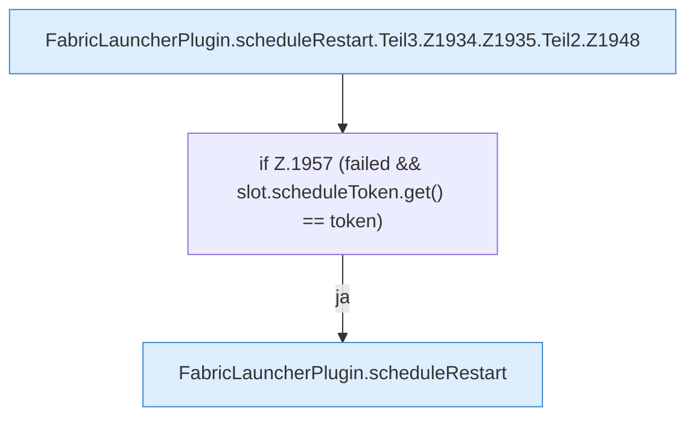

[[00 Start]] › [[Child-Prozess]] › [[Neustart]] › [[FabricLauncherPlugin.scheduleRestart]] › [[FabricLauncherPlugin.scheduleRestart.Teil3.Z1934.Z1935.Teil2]]

# FabricLauncherPlugin.scheduleRestart.Teil3.Z1934.Z1935.Teil2



```knoten
FabricLauncherPlugin.scheduleRestart.Teil3.Z1934.Z1935.Teil2.Z1948
  Der Ablauf geht in [[Glossar#Zeile|Zeile]] 1948 weiter. Eine Ebene tiefer steht er genauer. Fortsetzung des Ablaufs ab Zeile 1948.
if Z.1957 (failed && slot.scheduleToken.get() == token)
  Zeile 1957: prüft `(failed && slot.scheduleToken.get() == token)`.
FabricLauncherPlugin.scheduleRestart
  Wartet die [[Glossar#Pause|Pause]] und startet den [[Glossar#Spielserver|Spielserver]] dann neu. Am Anfang sind das fünf Sekunden, höchstens fünf Minuten. Plant `scheduleRestart`. Ruft `maxAttempts`, `mayRetry`, `notifyNtfy`.
```

> [!knoten]- Was die Blöcke tun
> - **FabricLauncherPlugin.scheduleRestart.Teil3.Z1934.Z1935.Teil2.Z1948**: Der Ablauf geht in [[Glossar#Zeile|Zeile]] 1948 weiter. Eine Ebene tiefer steht er genauer. Fortsetzung des Ablaufs ab Zeile 1948.
> - **if Z.1957 (failed && slot.scheduleToken.get() == token)**: Zeile 1957: prüft `(failed && slot.scheduleToken.get() == token)`.
> - **FabricLauncherPlugin.scheduleRestart**: Wartet die [[Glossar#Pause|Pause]] und startet den [[Glossar#Spielserver|Spielserver]] dann neu. Am Anfang sind das fünf Sekunden, höchstens fünf Minuten. Plant `scheduleRestart`. Ruft `maxAttempts`, `mayRetry`, `notifyNtfy`.

- Ein weiterer Abschnitt derselben Übersicht.
- Fortsetzung von `FabricLauncherPlugin.scheduleRestart.Teil3.Z1934.Z1935`.
