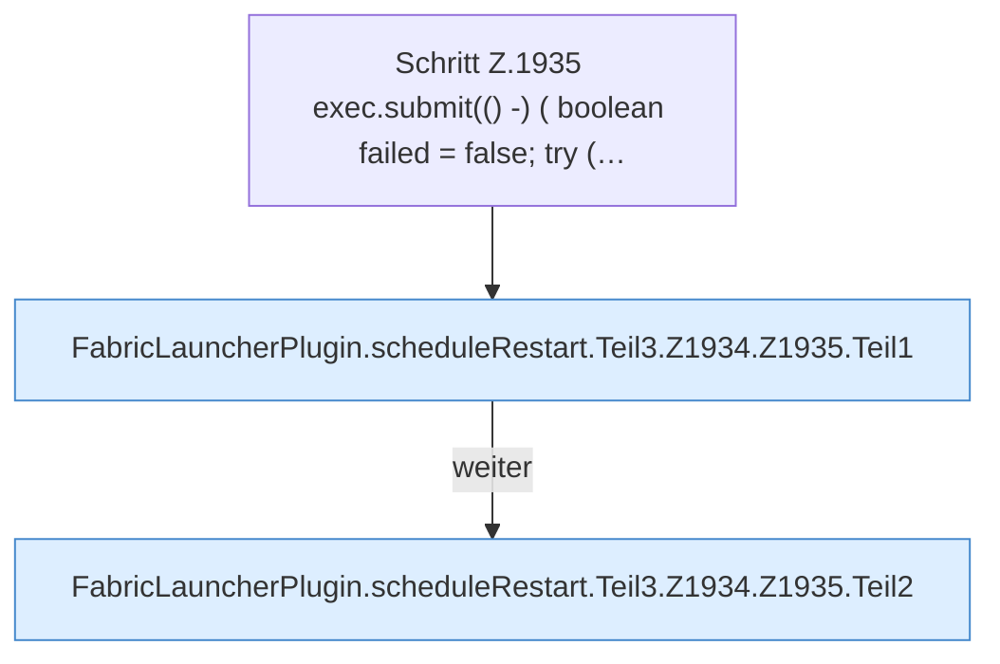

[[00 Start]] › [[Child-Prozess]] › [[Neustart]] › [[FabricLauncherPlugin.scheduleRestart]] › [[FabricLauncherPlugin.scheduleRestart.Teil3.Z1934.Z1935]]

# FabricLauncherPlugin.scheduleRestart.Teil3.Z1934.Z1935

- Fortsetzung von `FabricLauncherPlugin.scheduleRestart.Teil3.Z1934`, Quellreihenfolge.
