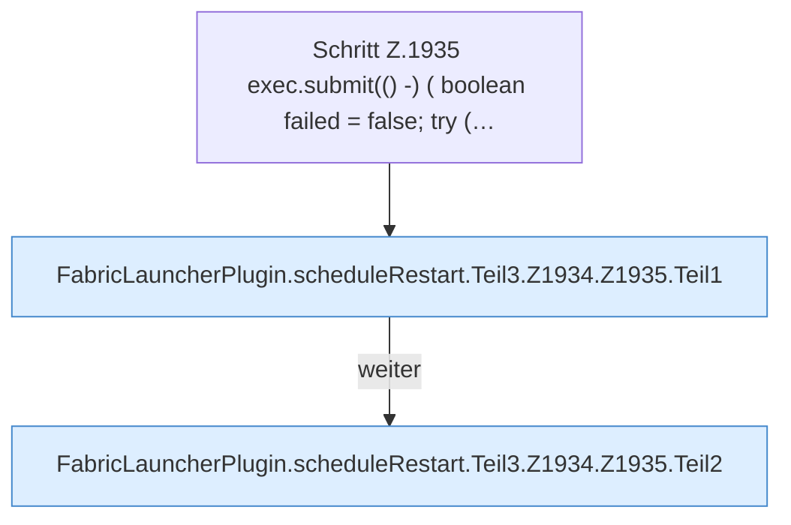

[[00 Start]] › [[Child-Prozess]] › [[Neustart]] › [[FabricLauncherPlugin.scheduleRestart]] › [[FabricLauncherPlugin.scheduleRestart.Teil3.Z1934.Z1935]]

# FabricLauncherPlugin.scheduleRestart.Teil3.Z1934.Z1935



```knoten
Schritt Z.1935 exec.submit(() -) ( boolean failed = false; try (…
  Zeile 1935: legt die Arbeit auf den Pool ServerhosterPlugin. `exec.submit(() -) ( boolean failed = false; try (…`
FabricLauncherPlugin.scheduleRestart.Teil3.Z1934.Z1935.Teil1
  Ein weiterer Abschnitt derselben Übersicht. Abschnitt 1 dieses Ablaufs, in Quellreihenfolge.
FabricLauncherPlugin.scheduleRestart.Teil3.Z1934.Z1935.Teil2
  Ein weiterer Abschnitt derselben Übersicht. Abschnitt 2 dieses Ablaufs, in Quellreihenfolge.
```

> [!knoten]- Was die Blöcke tun
> - **Schritt Z.1935 exec.submit(() -) ( boolean failed = false; try (…**: Zeile 1935: legt die Arbeit auf den Pool ServerhosterPlugin. `exec.submit(() -) ( boolean failed = false; try (…`
> - **FabricLauncherPlugin.scheduleRestart.Teil3.Z1934.Z1935.Teil1**: Ein weiterer Abschnitt derselben Übersicht. Abschnitt 1 dieses Ablaufs, in Quellreihenfolge.
> - **FabricLauncherPlugin.scheduleRestart.Teil3.Z1934.Z1935.Teil2**: Ein weiterer Abschnitt derselben Übersicht. Abschnitt 2 dieses Ablaufs, in Quellreihenfolge.

- Der Ablauf geht in [[Glossar#Zeile|Zeile]] 1935 weiter. Eine Ebene tiefer steht er genauer.
- Fortsetzung von `FabricLauncherPlugin.scheduleRestart.Teil3.Z1934`.
