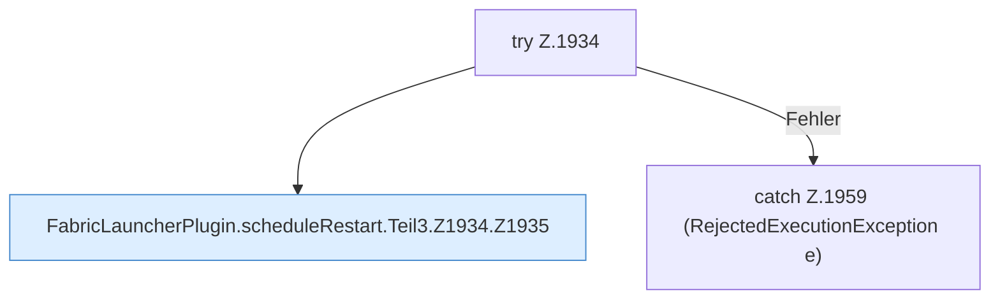

[[00 Start]] › [[Child-Prozess]] › [[Neustart]] › [[FabricLauncherPlugin.scheduleRestart]] › [[FabricLauncherPlugin.scheduleRestart.Teil3.Z1934]]

# FabricLauncherPlugin.scheduleRestart.Teil3.Z1934



```knoten
try Z.1934
  Zeile 1934: Versuch. Der Fehlerpfad geht in catch.
FabricLauncherPlugin.scheduleRestart.Teil3.Z1934.Z1935
  Der Ablauf geht in [[Glossar#Zeile|Zeile]] 1935 weiter. Eine Ebene tiefer steht er genauer. Fortsetzung des Ablaufs ab Zeile 1935.
catch Z.1959 (RejectedExecutionException e)
  Zeile 1959: fängt (RejectedExecutionException e).
```

> [!knoten]- Was die Blöcke tun
> - **try Z.1934**: Zeile 1934: Versuch. Der Fehlerpfad geht in catch.
> - **FabricLauncherPlugin.scheduleRestart.Teil3.Z1934.Z1935**: Der Ablauf geht in [[Glossar#Zeile|Zeile]] 1935 weiter. Eine Ebene tiefer steht er genauer. Fortsetzung des Ablaufs ab Zeile 1935.
> - **catch Z.1959 (RejectedExecutionException e)**: Zeile 1959: fängt (RejectedExecutionException e).

- Der Ablauf geht in [[Glossar#Zeile|Zeile]] 1934 weiter. Eine Ebene tiefer steht er genauer.
- Fortsetzung von `FabricLauncherPlugin.scheduleRestart.Teil3`.
