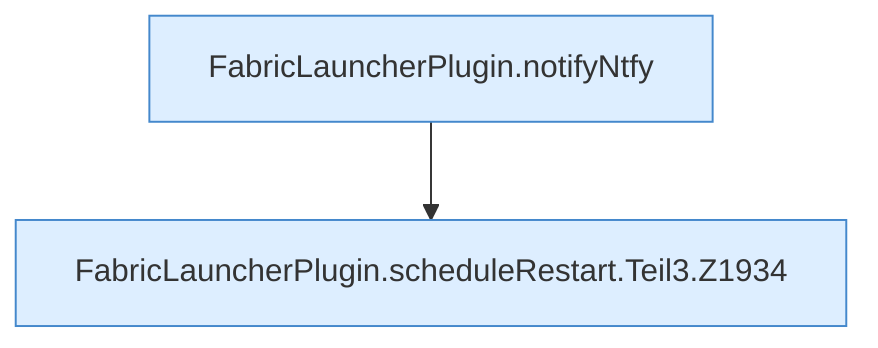

[[00 Start]] › [[Child-Prozess]] › [[Neustart]] › [[FabricLauncherPlugin.scheduleRestart]] › [[FabricLauncherPlugin.scheduleRestart.Teil3]]

# FabricLauncherPlugin.scheduleRestart.Teil3



```knoten
FabricLauncherPlugin.notifyNtfy
  Das [[Glossar#Plugin|Plugin]] meldet den Mitteilungsdienst. Meldet `notifyNtfy`. Ruft `ntfySettings`, `backupCredentials`, `send`.
FabricLauncherPlugin.scheduleRestart.Teil3.Z1934
  Der Ablauf geht in [[Glossar#Zeile|Zeile]] 1934 weiter. Eine Ebene tiefer steht er genauer. Fortsetzung des Ablaufs ab Zeile 1934.
```

> [!knoten]- Was die Blöcke tun
> - **FabricLauncherPlugin.notifyNtfy**: Das [[Glossar#Plugin|Plugin]] meldet den Mitteilungsdienst. Meldet `notifyNtfy`. Ruft `ntfySettings`, `backupCredentials`, `send`.
> - **FabricLauncherPlugin.scheduleRestart.Teil3.Z1934**: Der Ablauf geht in [[Glossar#Zeile|Zeile]] 1934 weiter. Eine Ebene tiefer steht er genauer. Fortsetzung des Ablaufs ab Zeile 1934.

- Ein weiterer Abschnitt derselben Übersicht.
- Fortsetzung von `FabricLauncherPlugin.scheduleRestart`.
