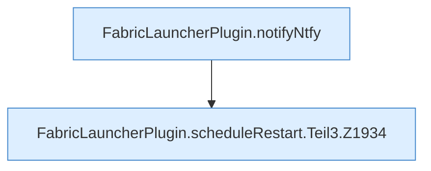

[[00 Start]] › [[Child-Prozess]] › [[Neustart]] › [[FabricLauncherPlugin.scheduleRestart]] › [[FabricLauncherPlugin.scheduleRestart.Teil3]]

# FabricLauncherPlugin.scheduleRestart.Teil3



```knoten
FabricLauncherPlugin.notifyNtfy
  Meldet `notifyNtfy`. Ruft `ntfySettings`, `backupCredentials`, `send`.
FabricLauncherPlugin.scheduleRestart.Teil3.Z1934
  Fortsetzung des Ablaufs ab Zeile 1934.
```

- Fortsetzung von `FabricLauncherPlugin.scheduleRestart`, Quellreihenfolge.
