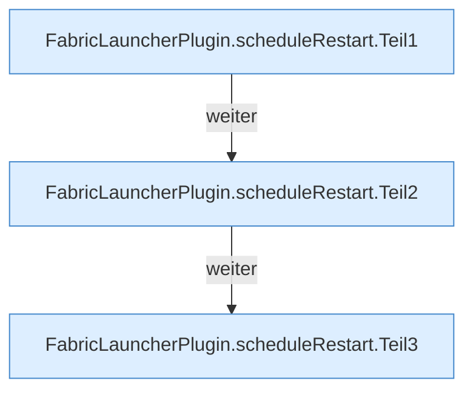
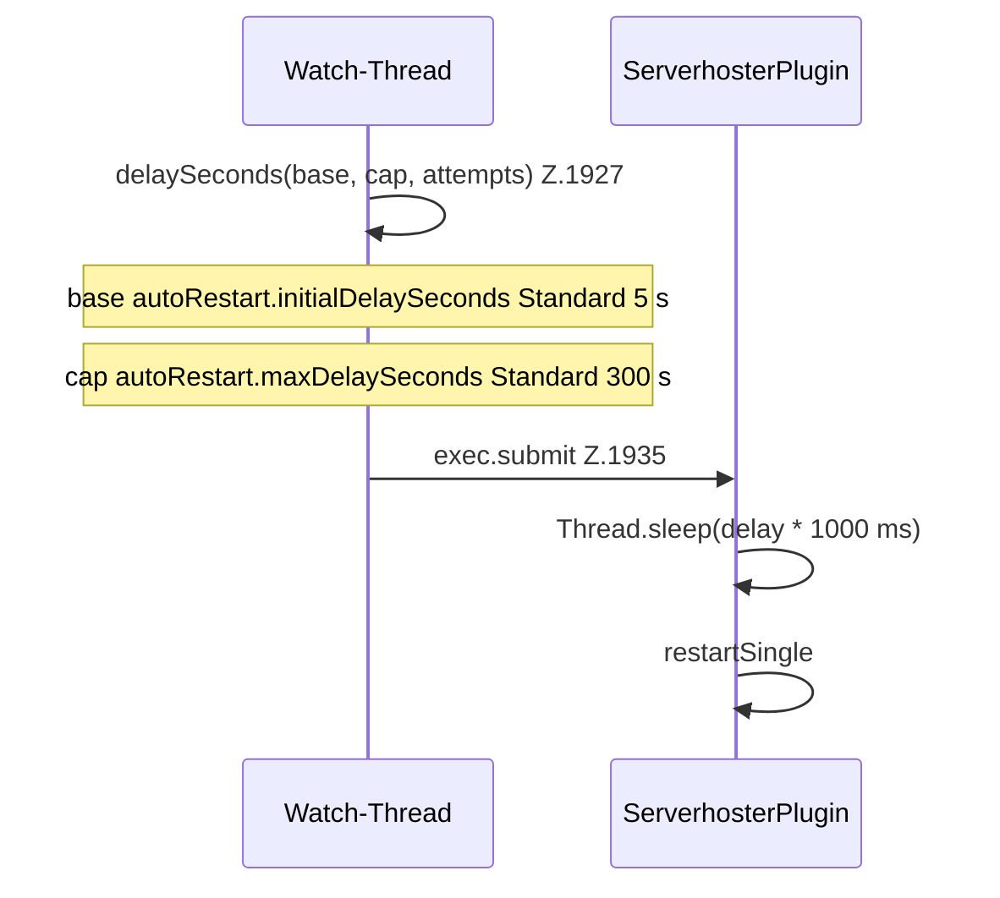

[[00 Start]] › [[Child-Prozess]] › [[Neustart]] › [[FabricLauncherPlugin.scheduleRestart]]

# FabricLauncherPlugin.scheduleRestart

`FabricLauncherPlugin.scheduleRestart(ChildSlot slot)` [src/main/java/de/aichele/childlauncher/FabricLauncherPlugin.java:1893–1963](https://github.com/Sciddie/minecraft-serverhoster-plugin/blob/95b02b953b0b4c23673e900e021a7c3c844aa37d/src/main/java/de/aichele/childlauncher/FabricLauncherPlugin.java#L1893-L1963)



```knoten
FabricLauncherPlugin.scheduleRestart.Teil1
  Abschnitt 1 dieses Ablaufs, in Quellreihenfolge.
FabricLauncherPlugin.scheduleRestart.Teil2
  Abschnitt 2 dieses Ablaufs, in Quellreihenfolge.
FabricLauncherPlugin.scheduleRestart.Teil3
  Abschnitt 3 dieses Ablaufs, in Quellreihenfolge.
```



- `scheduleRestart` in `src/main/java/de/aichele/childlauncher/FabricLauncherPlugin.java`
