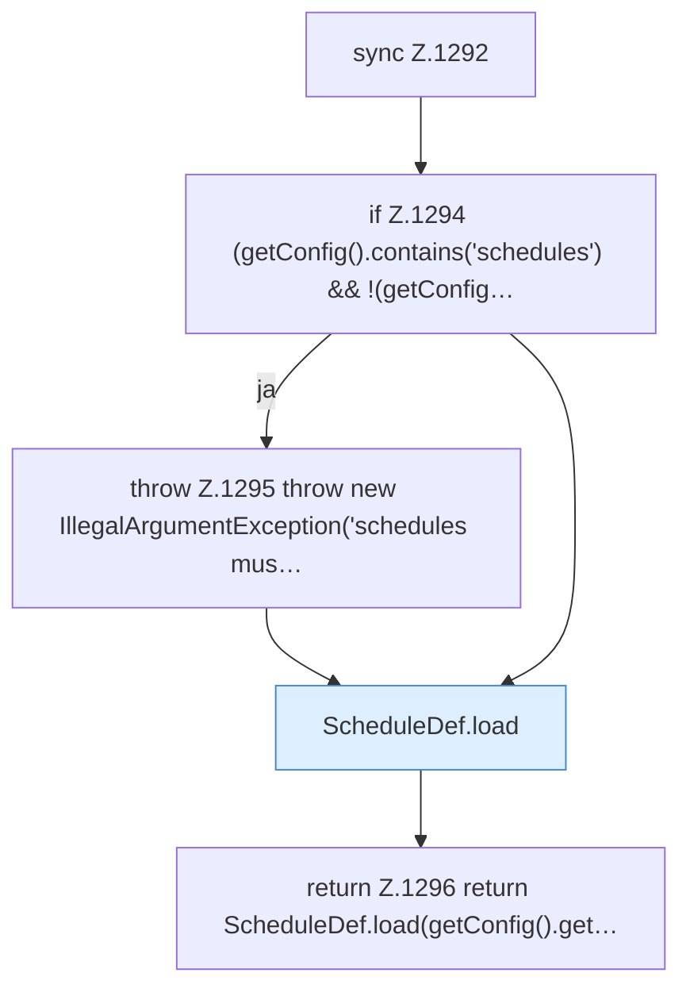

[[00 Start]] › [[Zeitplaene]] › [[Schedules]] › [[FabricLauncherPlugin.schedules]]

# FabricLauncherPlugin.schedules

`FabricLauncherPlugin.schedules()` [src/main/java/de/aichele/childlauncher/FabricLauncherPlugin.java:1292–1298](https://github.com/Sciddie/minecraft-serverhoster-plugin/blob/95b02b953b0b4c23673e900e021a7c3c844aa37d/src/main/java/de/aichele/childlauncher/FabricLauncherPlugin.java#L1292-L1298)



```knoten
sync Z.1292
  Hier wartet die [[Glossar#Funktion|Funktion]], damit nicht zwei Arbeitsstränge denselben Schritt gleichzeitig machen. Das steht in [[Glossar#Zeile|Zeile]] 1292.
if Z.1294 (getConfig().contains('schedules') && !(getConfig…
  Hier fällt eine Entscheidung. Nur wenn sie zutrifft, geht es den Ja-Weg weiter. Das steht in [[Glossar#Zeile|Zeile]] 1294.
throw Z.1295 throw new IllegalArgumentException('schedules mus…
  Hier bricht die [[Glossar#Funktion|Funktion]] ab, weil etwas nicht geklappt hat. Das steht in [[Glossar#Zeile|Zeile]] 1295.
ScheduleDef.load
  Der [[Glossar#Zeitplan|Zeitplan]] lädt das. Im [[Glossar#Quelltext|Quelltext]] heißt das `load`.
return Z.1296 return ScheduleDef.load(getConfig().get…
  Hier endet die [[Glossar#Funktion|Funktion]] und liefert ein Ergebnis zurück. Das steht in [[Glossar#Zeile|Zeile]] 1296.
```

> [!knoten]- Was die Blöcke tun
> - **sync Z.1292**: Hier wartet die [[Glossar#Funktion|Funktion]], damit nicht zwei Arbeitsstränge denselben Schritt gleichzeitig machen. Das steht in [[Glossar#Zeile|Zeile]] 1292.
> - **if Z.1294 (getConfig().contains('schedules') && !(getConfig…**: Hier fällt eine Entscheidung. Nur wenn sie zutrifft, geht es den Ja-Weg weiter. Das steht in [[Glossar#Zeile|Zeile]] 1294.
> - **throw Z.1295 throw new IllegalArgumentException('schedules mus…**: Hier bricht die [[Glossar#Funktion|Funktion]] ab, weil etwas nicht geklappt hat. Das steht in [[Glossar#Zeile|Zeile]] 1295.
> - **ScheduleDef.load**: Der [[Glossar#Zeitplan|Zeitplan]] lädt das. Im [[Glossar#Quelltext|Quelltext]] heißt das `load`.
> - **return Z.1296 return ScheduleDef.load(getConfig().get…**: Hier endet die [[Glossar#Funktion|Funktion]] und liefert ein Ergebnis zurück. Das steht in [[Glossar#Zeile|Zeile]] 1296.

- Das [[Glossar#Plugin|Plugin]] macht hier einen einzelnen Schritt. Eine Ebene tiefer steht er genauer.
