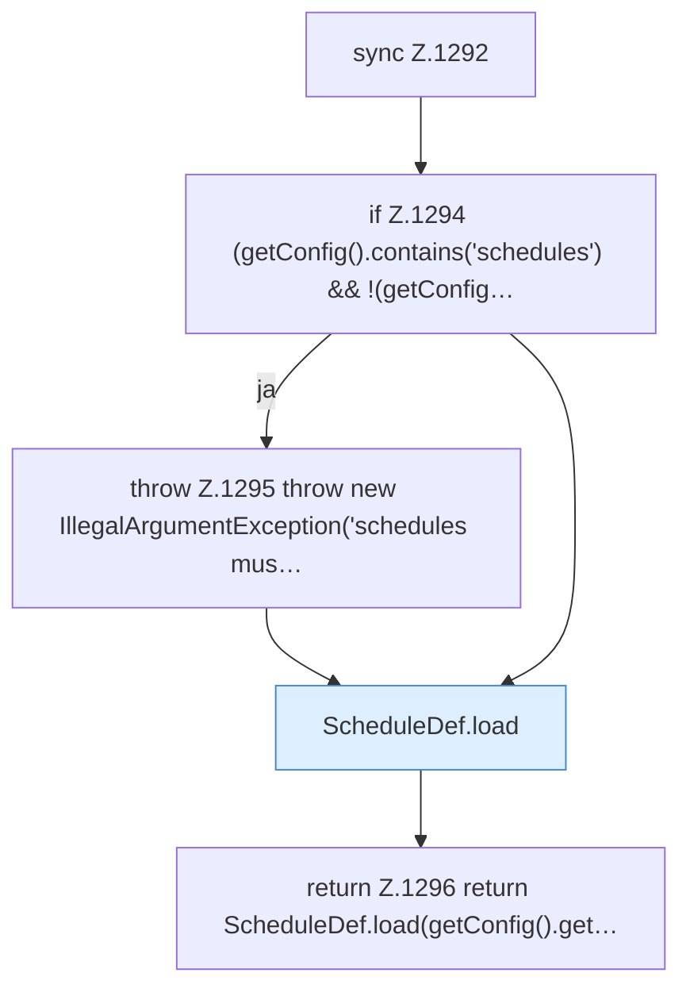

[[00 Start]] › [[Zeitplaene]] › [[Schedules]] › [[FabricLauncherPlugin.schedules]]

# FabricLauncherPlugin.schedules

`FabricLauncherPlugin.schedules()` [src/main/java/de/aichele/childlauncher/FabricLauncherPlugin.java:1292–1298](https://github.com/Sciddie/minecraft-serverhoster-plugin/blob/95b02b953b0b4c23673e900e021a7c3c844aa37d/src/main/java/de/aichele/childlauncher/FabricLauncherPlugin.java#L1292-L1298)

- `schedules` in `src/main/java/de/aichele/childlauncher/FabricLauncherPlugin.java`
