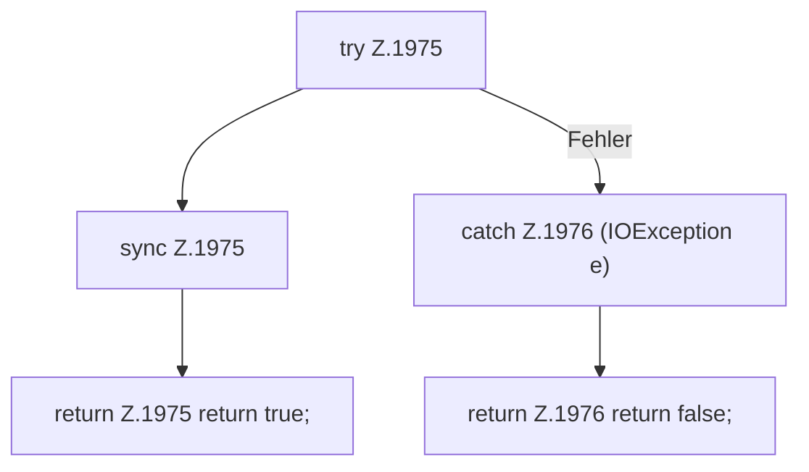

[[00 Start]] › [[Plugin-Kern]] › [[Slot-Aktionen]] › [[FabricLauncherPlugin.send]] › [[FabricLauncherPlugin.send.Z1975]]

# FabricLauncherPlugin.send.Z1975



```knoten
try Z.1975
  Zeile 1975: Versuch. Der Fehlerpfad geht in catch.
sync Z.1975
  Zeile 1975: synchronisierter Block.
return Z.1975 return true;
  Zeile 1975: Rückgabe `return true;`.
catch Z.1976 (IOException e)
  Zeile 1976: fängt (IOException e).
return Z.1976 return false;
  Zeile 1976: Rückgabe `return false;`.
```

- Fortsetzung von `FabricLauncherPlugin.send`, Quellreihenfolge.
