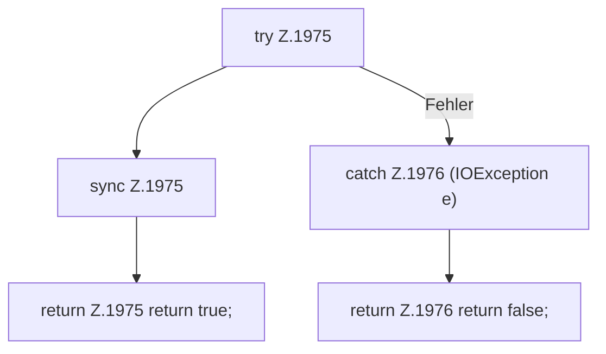

[[00 Start]] › [[Plugin-Kern]] › [[Slot-Aktionen]] › [[FabricLauncherPlugin.send]] › [[FabricLauncherPlugin.send.Z1975]]

# FabricLauncherPlugin.send.Z1975

- Fortsetzung von `FabricLauncherPlugin.send`, Quellreihenfolge.
