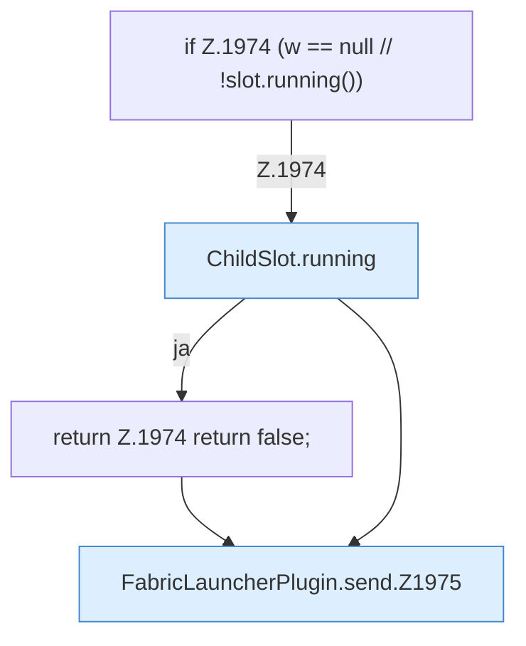

[[00 Start]] › [[Plugin-Kern]] › [[Slot-Aktionen]] › [[FabricLauncherPlugin.send]]

# FabricLauncherPlugin.send

`FabricLauncherPlugin.send(ChildSlot slot, String command)` [src/main/java/de/aichele/childlauncher/FabricLauncherPlugin.java:1972–1977](https://github.com/Sciddie/minecraft-serverhoster-plugin/blob/95b02b953b0b4c23673e900e021a7c3c844aa37d/src/main/java/de/aichele/childlauncher/FabricLauncherPlugin.java#L1972-L1977)



```knoten
if Z.1974 (w == null // !slot.running())
  Zeile 1974: prüft `(w == null // !slot.running())`.
ChildSlot.running
  Sagt, ob der Prozess läuft `running`.
return Z.1974 return false;
  Zeile 1974: Rückgabe `return false;`.
FabricLauncherPlugin.send.Z1975
  Fortsetzung des Ablaufs ab Zeile 1975.
```

- `send` in `src/main/java/de/aichele/childlauncher/FabricLauncherPlugin.java`
