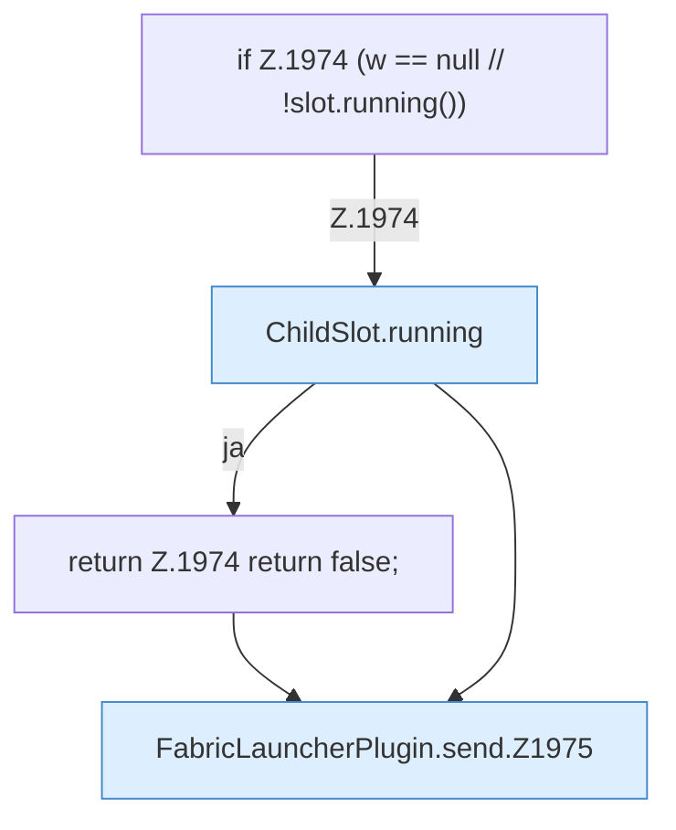

[[00 Start]] › [[Plugin-Kern]] › [[Slot-Aktionen]] › [[FabricLauncherPlugin.send]]

# FabricLauncherPlugin.send

`FabricLauncherPlugin.send(ChildSlot slot, String command)` [src/main/java/de/aichele/childlauncher/FabricLauncherPlugin.java:1972–1977](https://github.com/Sciddie/minecraft-serverhoster-plugin/blob/95b02b953b0b4c23673e900e021a7c3c844aa37d/src/main/java/de/aichele/childlauncher/FabricLauncherPlugin.java#L1972-L1977)



```knoten
if Z.1974 (w == null // !slot.running())
  Hier fällt eine Entscheidung. Nur wenn sie zutrifft, geht es den Ja-Weg weiter. Das steht in [[Glossar#Zeile|Zeile]] 1974.
ChildSlot.running
  Dieser Teil prüft, ob läuft, das. Im [[Glossar#Quelltext|Quelltext]] heißt das `running`.
return Z.1974 return false;
  Hier endet die [[Glossar#Funktion|Funktion]] und liefert ein Ergebnis zurück. Das steht in [[Glossar#Zeile|Zeile]] 1974.
FabricLauncherPlugin.send.Z1975
  Der Ablauf geht in [[Glossar#Zeile|Zeile]] 1975 weiter. Eine Ebene tiefer steht er genauer. Im [[Glossar#Quelltext|Quelltext]] heißt das `Z1975`.
```

> [!knoten]- Was die Blöcke tun
> - **if Z.1974 (w == null // !slot.running())**: Hier fällt eine Entscheidung. Nur wenn sie zutrifft, geht es den Ja-Weg weiter. Das steht in [[Glossar#Zeile|Zeile]] 1974.
> - **ChildSlot.running**: Dieser Teil prüft, ob läuft, das. Im [[Glossar#Quelltext|Quelltext]] heißt das `running`.
> - **return Z.1974 return false;**: Hier endet die [[Glossar#Funktion|Funktion]] und liefert ein Ergebnis zurück. Das steht in [[Glossar#Zeile|Zeile]] 1974.
> - **FabricLauncherPlugin.send.Z1975**: Der Ablauf geht in [[Glossar#Zeile|Zeile]] 1975 weiter. Eine Ebene tiefer steht er genauer. Im [[Glossar#Quelltext|Quelltext]] heißt das `Z1975`.

- Schickt Text an den laufenden [[Glossar#Spielserver|Spielserver]].
