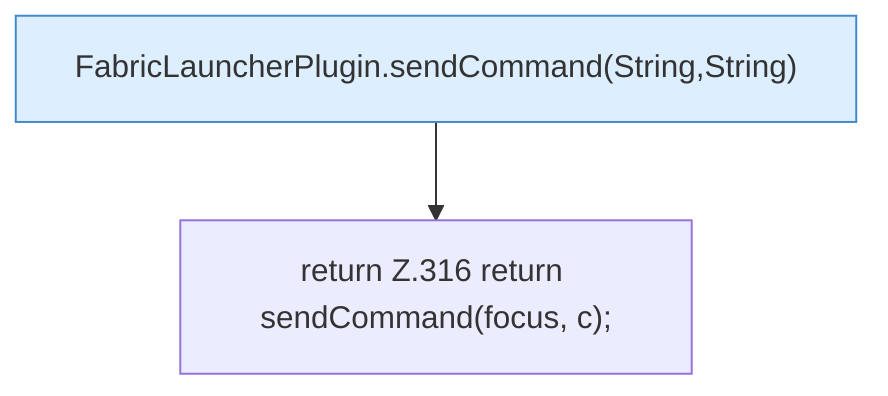

[[00 Start]] › [[Plugin-Kern]] › [[Slot-Aktionen]] › [[FabricLauncherPlugin.sendCommand(String)]]

# FabricLauncherPlugin.sendCommand(String)

`FabricLauncherPlugin.sendCommand(String c)` [src/main/java/de/aichele/childlauncher/FabricLauncherPlugin.java:316–316](https://github.com/Sciddie/minecraft-serverhoster-plugin/blob/95b02b953b0b4c23673e900e021a7c3c844aa37d/src/main/java/de/aichele/childlauncher/FabricLauncherPlugin.java#L316-L316)

- `sendCommand` in `src/main/java/de/aichele/childlauncher/FabricLauncherPlugin.java`
