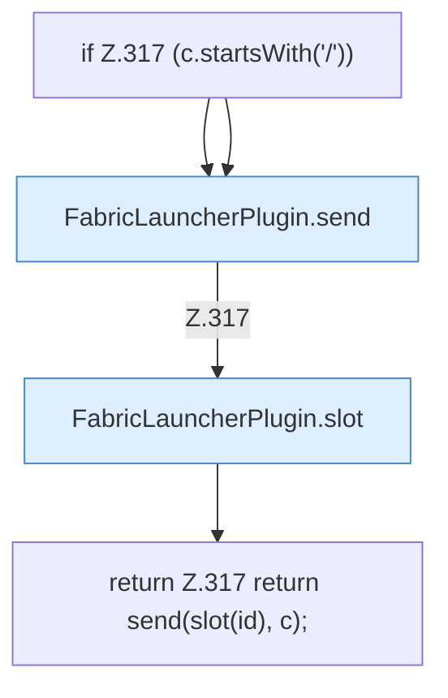

[[00 Start]] › [[Plugin-Kern]] › [[Slot-Aktionen]] › [[FabricLauncherPlugin.sendCommand(String,String)]]

# FabricLauncherPlugin.sendCommand(String,String)

`FabricLauncherPlugin.sendCommand(String id, String c)` [src/main/java/de/aichele/childlauncher/FabricLauncherPlugin.java:317–317](https://github.com/Sciddie/minecraft-serverhoster-plugin/blob/95b02b953b0b4c23673e900e021a7c3c844aa37d/src/main/java/de/aichele/childlauncher/FabricLauncherPlugin.java#L317-L317)



```knoten
if Z.317 (c.startsWith('/'))
  Zeile 317: prüft `(c.startsWith('/'))`.
FabricLauncherPlugin.send
  Sendet `send`. Ruft `running`.
FabricLauncherPlugin.slot
  `slot` in `FabricLauncherPlugin.java`. Ruft `profile`, `ChildSlot`.
return Z.317 return send(slot(id), c);
  Zeile 317: Rückgabe `return send(slot(id), c);`.
```

- `sendCommand` in `src/main/java/de/aichele/childlauncher/FabricLauncherPlugin.java`
