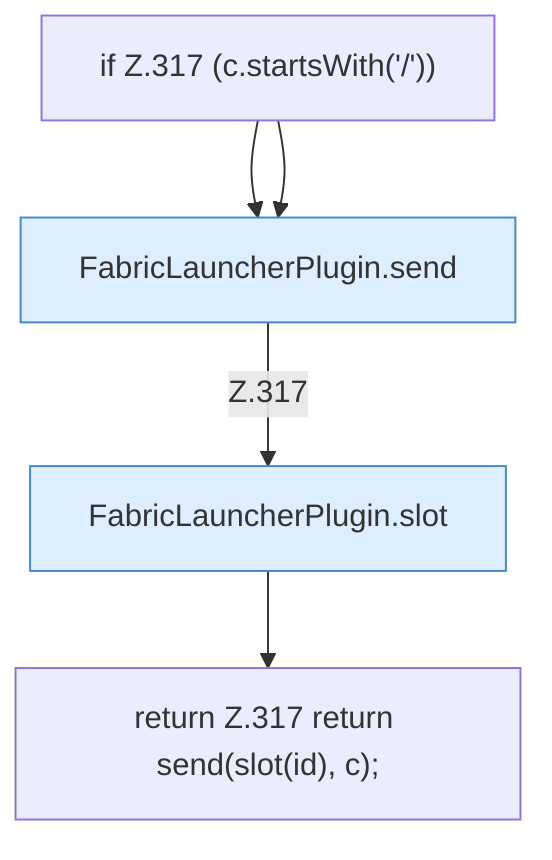

[[00 Start]] › [[Plugin-Kern]] › [[Slot-Aktionen]] › [[FabricLauncherPlugin.sendCommand(String,String)]]

# FabricLauncherPlugin.sendCommand(String,String)

`FabricLauncherPlugin.sendCommand(String id, String c)` [src/main/java/de/aichele/childlauncher/FabricLauncherPlugin.java:317–317](https://github.com/Sciddie/minecraft-serverhoster-plugin/blob/95b02b953b0b4c23673e900e021a7c3c844aa37d/src/main/java/de/aichele/childlauncher/FabricLauncherPlugin.java#L317-L317)



```knoten
if Z.317 (c.startsWith('/'))
  Hier fällt eine Entscheidung. Nur wenn sie zutrifft, geht es den Ja-Weg weiter. Das steht in [[Glossar#Zeile|Zeile]] 317.
FabricLauncherPlugin.send
  Schickt Text an den laufenden [[Glossar#Spielserver|Spielserver]]. Im [[Glossar#Quelltext|Quelltext]] heißt das `send`.
FabricLauncherPlugin.slot
  Das [[Glossar#Plugin|Plugin]] macht hier einen einzelnen Schritt. Eine Ebene tiefer steht er genauer. Im [[Glossar#Quelltext|Quelltext]] heißt das `slot`.
return Z.317 return send(slot(id), c);
  Hier endet die [[Glossar#Funktion|Funktion]] und liefert ein Ergebnis zurück. Das steht in [[Glossar#Zeile|Zeile]] 317.
```

> [!knoten]- Was die Blöcke tun
> - **if Z.317 (c.startsWith('/'))**: Hier fällt eine Entscheidung. Nur wenn sie zutrifft, geht es den Ja-Weg weiter. Das steht in [[Glossar#Zeile|Zeile]] 317.
> - **FabricLauncherPlugin.send**: Schickt Text an den laufenden [[Glossar#Spielserver|Spielserver]]. Im [[Glossar#Quelltext|Quelltext]] heißt das `send`.
> - **FabricLauncherPlugin.slot**: Das [[Glossar#Plugin|Plugin]] macht hier einen einzelnen Schritt. Eine Ebene tiefer steht er genauer. Im [[Glossar#Quelltext|Quelltext]] heißt das `slot`.
> - **return Z.317 return send(slot(id), c);**: Hier endet die [[Glossar#Funktion|Funktion]] und liefert ein Ergebnis zurück. Das steht in [[Glossar#Zeile|Zeile]] 317.

- Schickt einen [[Glossar#Befehl|Befehl]] in die [[Glossar#Konsole|Konsole]] des [[Glossar#Spielserver|Spielservers]].
