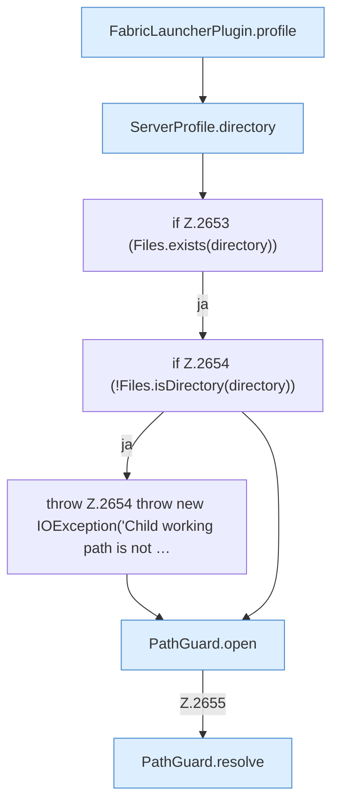

[[00 Start]] › [[Plugin-Kern]] › [[Properties]] › [[FabricLauncherPlugin.serverPropertiesPreview]] › [[FabricLauncherPlugin.serverPropertiesPreview.Teil1]]

# FabricLauncherPlugin.serverPropertiesPreview.Teil1



```knoten
FabricLauncherPlugin.profile
  `profile` in `FabricLauncherPlugin.java`.
ServerProfile.directory
  `directory` in `ServerProfile.java`.
if Z.2653 (Files.exists(directory))
  Zeile 2653: prüft `(Files.exists(directory))`.
if Z.2654 (!Files.isDirectory(directory))
  Zeile 2654: prüft `(!Files.isDirectory(directory))`.
throw Z.2654 throw new IOException('Child working path is not …
  Zeile 2654: Abbruch `throw new IOException('Child working path is not …`.
PathGuard.open
  Öffnet `open`. Ruft `PathGuard`.
PathGuard.resolve
  Löst auf `resolve`.
```

- Fortsetzung von `FabricLauncherPlugin.serverPropertiesPreview`, Quellreihenfolge.
