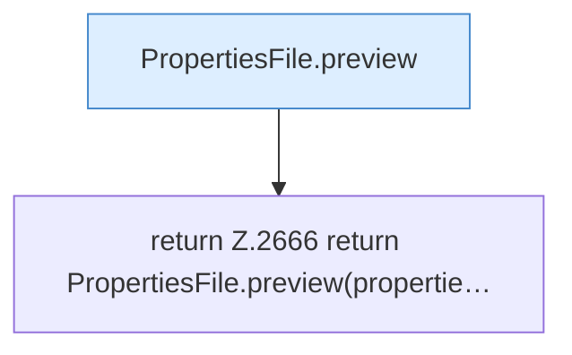

[[00 Start]] › [[Plugin-Kern]] › [[Properties]] › [[FabricLauncherPlugin.serverPropertiesPreview]] › [[FabricLauncherPlugin.serverPropertiesPreview.Teil3]]

# FabricLauncherPlugin.serverPropertiesPreview.Teil3

- Fortsetzung von `FabricLauncherPlugin.serverPropertiesPreview`, Quellreihenfolge.
