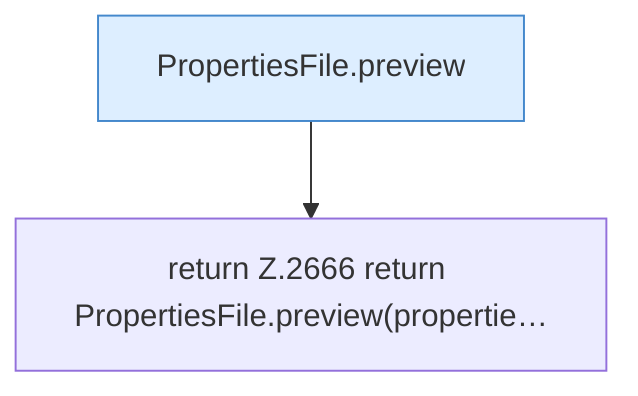

[[00 Start]] › [[Plugin-Kern]] › [[Properties]] › [[FabricLauncherPlugin.serverPropertiesPreview]] › [[FabricLauncherPlugin.serverPropertiesPreview.Teil3]]

# FabricLauncherPlugin.serverPropertiesPreview.Teil3



```knoten
PropertiesFile.preview
  Zeigt die Vorschau `preview`.
return Z.2666 return PropertiesFile.preview(propertie…
  Zeile 2666: Rückgabe `return PropertiesFile.preview(propertie…`.
```

- Fortsetzung von `FabricLauncherPlugin.serverPropertiesPreview`, Quellreihenfolge.
