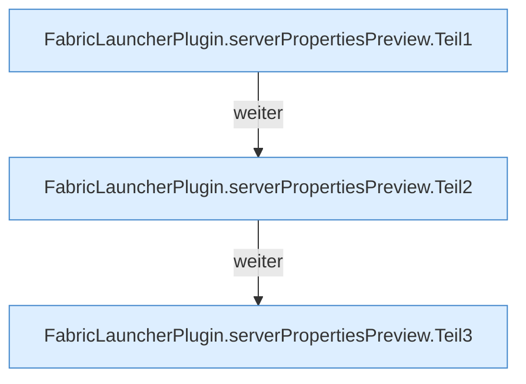

[[00 Start]] › [[Plugin-Kern]] › [[Properties]] › [[FabricLauncherPlugin.serverPropertiesPreview]]

# FabricLauncherPlugin.serverPropertiesPreview

`FabricLauncherPlugin.serverPropertiesPreview(String id)` [src/main/java/de/aichele/childlauncher/FabricLauncherPlugin.java:2649–2667](https://github.com/Sciddie/minecraft-serverhoster-plugin/blob/95b02b953b0b4c23673e900e021a7c3c844aa37d/src/main/java/de/aichele/childlauncher/FabricLauncherPlugin.java#L2649-L2667)

- `serverPropertiesPreview` in `src/main/java/de/aichele/childlauncher/FabricLauncherPlugin.java`
