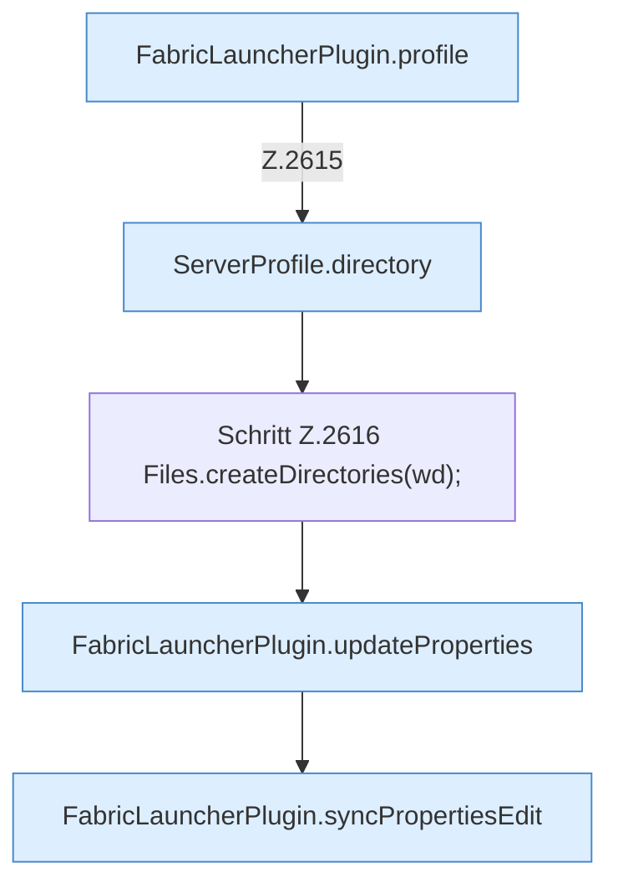

[[00 Start]] › [[Plugin-Kern]] › [[Properties]] › [[FabricLauncherPlugin.setChildProperty(String,String,String)]]

# FabricLauncherPlugin.setChildProperty(String,String,String)

`FabricLauncherPlugin.setChildProperty(String id, String key, String value)` [src/main/java/de/aichele/childlauncher/FabricLauncherPlugin.java:2614–2621](https://github.com/Sciddie/minecraft-serverhoster-plugin/blob/95b02b953b0b4c23673e900e021a7c3c844aa37d/src/main/java/de/aichele/childlauncher/FabricLauncherPlugin.java#L2614-L2621)

- `setChildProperty` in `src/main/java/de/aichele/childlauncher/FabricLauncherPlugin.java`
