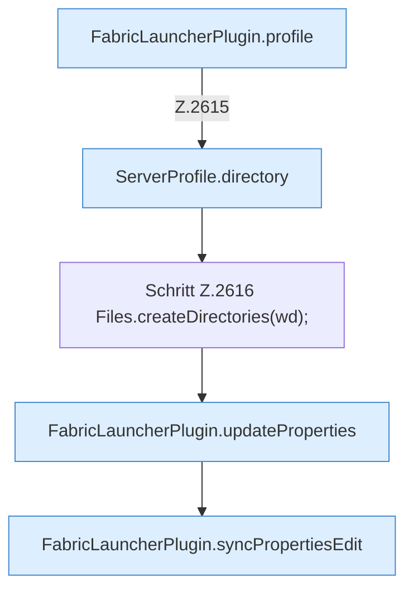

[[00 Start]] › [[Plugin-Kern]] › [[Properties]] › [[FabricLauncherPlugin.setChildProperty(String,String,String)]]

# FabricLauncherPlugin.setChildProperty(String,String,String)

`FabricLauncherPlugin.setChildProperty(String id, String key, String value)` [src/main/java/de/aichele/childlauncher/FabricLauncherPlugin.java:2614–2621](https://github.com/Sciddie/minecraft-serverhoster-plugin/blob/95b02b953b0b4c23673e900e021a7c3c844aa37d/src/main/java/de/aichele/childlauncher/FabricLauncherPlugin.java#L2614-L2621)



```knoten
FabricLauncherPlugin.profile
  Das [[Glossar#Plugin|Plugin]] macht hier einen einzelnen Schritt. Eine Ebene tiefer steht er genauer. Im [[Glossar#Quelltext|Quelltext]] heißt das `profile`.
ServerProfile.directory
  Die Serverbeschreibung macht hier einen einzelnen Schritt. Eine Ebene tiefer steht er genauer. Im [[Glossar#Quelltext|Quelltext]] heißt das `directory`.
Schritt Z.2616 Files.createDirectories(wd);
  Ein einzelner Arbeitsschritt, ohne eine weitere eigene [[Glossar#Funktion|Funktion]] aufzurufen. Das steht in [[Glossar#Zeile|Zeile]] 2616.
FabricLauncherPlugin.updateProperties
  Das [[Glossar#Plugin|Plugin]] ändert die Eigenschaften. Im [[Glossar#Quelltext|Quelltext]] heißt das `updateProperties`.
FabricLauncherPlugin.syncPropertiesEdit
  Das [[Glossar#Plugin|Plugin]] gleicht ab die Eigenschaften die Bearbeitung. Im [[Glossar#Quelltext|Quelltext]] heißt das `syncPropertiesEdit`.
```

> [!knoten]- Was die Blöcke tun
> - **FabricLauncherPlugin.profile**: Das [[Glossar#Plugin|Plugin]] macht hier einen einzelnen Schritt. Eine Ebene tiefer steht er genauer. Im [[Glossar#Quelltext|Quelltext]] heißt das `profile`.
> - **ServerProfile.directory**: Die Serverbeschreibung macht hier einen einzelnen Schritt. Eine Ebene tiefer steht er genauer. Im [[Glossar#Quelltext|Quelltext]] heißt das `directory`.
> - **Schritt Z.2616 Files.createDirectories(wd);**: Ein einzelner Arbeitsschritt, ohne eine weitere eigene [[Glossar#Funktion|Funktion]] aufzurufen. Das steht in [[Glossar#Zeile|Zeile]] 2616.
> - **FabricLauncherPlugin.updateProperties**: Das [[Glossar#Plugin|Plugin]] ändert die Eigenschaften. Im [[Glossar#Quelltext|Quelltext]] heißt das `updateProperties`.
> - **FabricLauncherPlugin.syncPropertiesEdit**: Das [[Glossar#Plugin|Plugin]] gleicht ab die Eigenschaften die Bearbeitung. Im [[Glossar#Quelltext|Quelltext]] heißt das `syncPropertiesEdit`.

- Das [[Glossar#Plugin|Plugin]] setzt den [[Glossar#Spielserver|Spielserver]] eine Eigenschaft.
