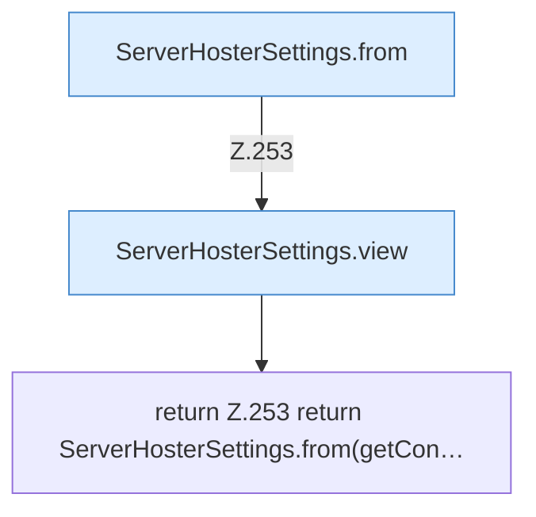

[[00 Start]] › [[Plugin-Kern]] › [[Konfiguration]] › [[FabricLauncherPlugin.settingsView]]

# FabricLauncherPlugin.settingsView

`FabricLauncherPlugin.settingsView()` [src/main/java/de/aichele/childlauncher/FabricLauncherPlugin.java:252–254](https://github.com/Sciddie/minecraft-serverhoster-plugin/blob/95b02b953b0b4c23673e900e021a7c3c844aa37d/src/main/java/de/aichele/childlauncher/FabricLauncherPlugin.java#L252-L254)



```knoten
ServerHosterSettings.from
  `from` in `ServerHosterSettings.java`. Ruft `ServerHosterSettings`.
ServerHosterSettings.view
  Liefert die Sicht `view`.
return Z.253 return ServerHosterSettings.from(getCon…
  Zeile 253: Rückgabe `return ServerHosterSettings.from(getCon…`.
```

- `settingsView` in `src/main/java/de/aichele/childlauncher/FabricLauncherPlugin.java`
