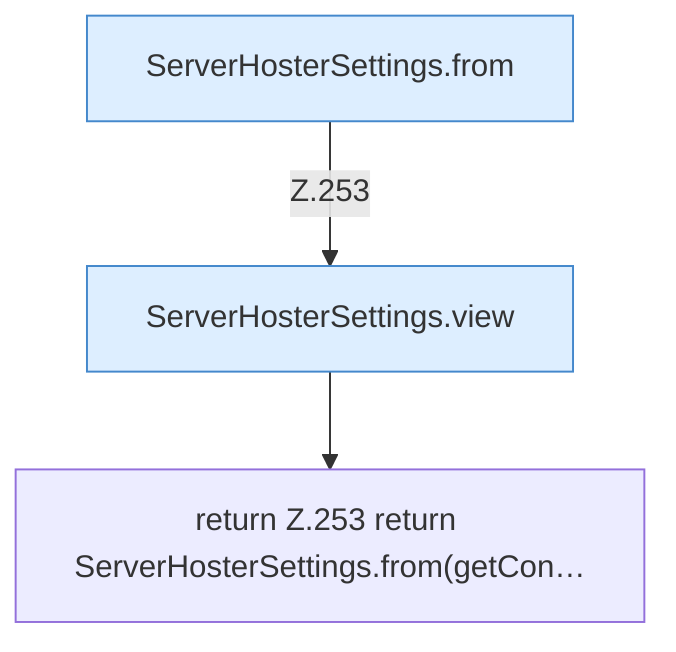

[[00 Start]] › [[Plugin-Kern]] › [[Konfiguration]] › [[FabricLauncherPlugin.settingsView]]

# FabricLauncherPlugin.settingsView

`FabricLauncherPlugin.settingsView()` [src/main/java/de/aichele/childlauncher/FabricLauncherPlugin.java:252–254](https://github.com/Sciddie/minecraft-serverhoster-plugin/blob/95b02b953b0b4c23673e900e021a7c3c844aa37d/src/main/java/de/aichele/childlauncher/FabricLauncherPlugin.java#L252-L254)



```knoten
ServerHosterSettings.from
  Dieser Teil macht hier einen einzelnen Schritt. Eine Ebene tiefer steht er genauer. Im [[Glossar#Quelltext|Quelltext]] heißt das `from`.
ServerHosterSettings.view
  Dieser Teil macht hier einen einzelnen Schritt. Eine Ebene tiefer steht er genauer. Im [[Glossar#Quelltext|Quelltext]] heißt das `view`.
return Z.253 return ServerHosterSettings.from(getCon…
  Hier endet die [[Glossar#Funktion|Funktion]] und liefert ein Ergebnis zurück. Das steht in [[Glossar#Zeile|Zeile]] 253.
```

> [!knoten]- Was die Blöcke tun
> - **ServerHosterSettings.from**: Dieser Teil macht hier einen einzelnen Schritt. Eine Ebene tiefer steht er genauer. Im [[Glossar#Quelltext|Quelltext]] heißt das `from`.
> - **ServerHosterSettings.view**: Dieser Teil macht hier einen einzelnen Schritt. Eine Ebene tiefer steht er genauer. Im [[Glossar#Quelltext|Quelltext]] heißt das `view`.
> - **return Z.253 return ServerHosterSettings.from(getCon…**: Hier endet die [[Glossar#Funktion|Funktion]] und liefert ein Ergebnis zurück. Das steht in [[Glossar#Zeile|Zeile]] 253.

- Stellt die [[Glossar#Einstellungen|Einstellungen]] so zusammen, wie die [[Glossar#Bedienseite|Bedienseite]] sie anzeigt.
