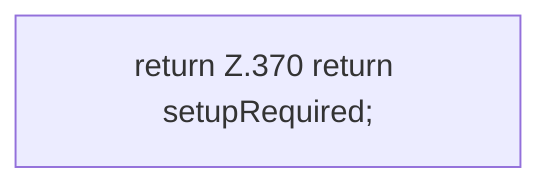

[[00 Start]] › [[Plugin-Kern]] › [[Setup]] › [[Setup-Dialog]] › [[FabricLauncherPlugin.setupRequired]]

# FabricLauncherPlugin.setupRequired

`FabricLauncherPlugin.setupRequired()` [src/main/java/de/aichele/childlauncher/FabricLauncherPlugin.java:370–370](https://github.com/Sciddie/minecraft-serverhoster-plugin/blob/95b02b953b0b4c23673e900e021a7c3c844aa37d/src/main/java/de/aichele/childlauncher/FabricLauncherPlugin.java#L370-L370)



```knoten
return Z.370 return setupRequired;
  Zeile 370: Rückgabe `return setupRequired;`.
```

- `setupRequired` in `src/main/java/de/aichele/childlauncher/FabricLauncherPlugin.java`
