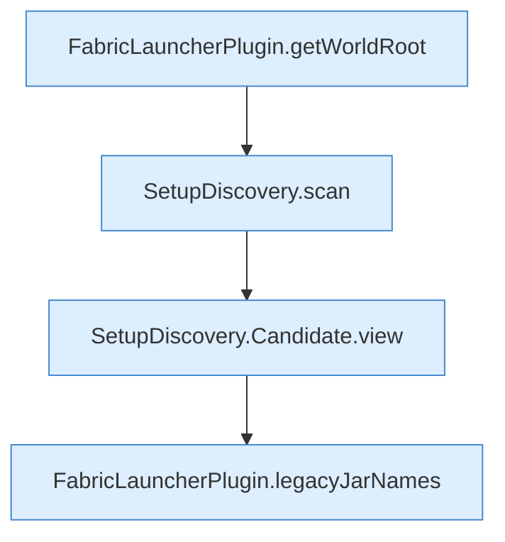

[[00 Start]] › [[Plugin-Kern]] › [[Setup]] › [[Setup-Dialog]] › [[FabricLauncherPlugin.setupView]] › [[FabricLauncherPlugin.setupView.Teil1]]

# FabricLauncherPlugin.setupView.Teil1

- Fortsetzung von `FabricLauncherPlugin.setupView`, Quellreihenfolge.
