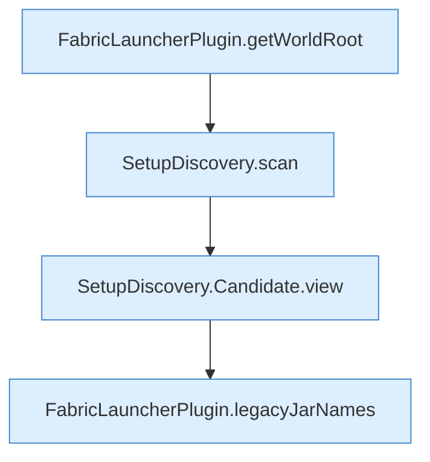

[[00 Start]] › [[Plugin-Kern]] › [[Setup]] › [[Setup-Dialog]] › [[FabricLauncherPlugin.setupView]] › [[FabricLauncherPlugin.setupView.Teil1]]

# FabricLauncherPlugin.setupView.Teil1



```knoten
FabricLauncherPlugin.getWorldRoot
  Das [[Glossar#Plugin|Plugin]] liefert die [[Glossar#Spielwelt|Spielwelt]] den Anfang. Liefert `getWorldRoot`.
SetupDiscovery.scan
  Dieser Teil macht hier einen einzelnen Schritt. Eine Ebene tiefer steht er genauer. Durchsucht `scan`. Ruft `legacyPluginVersion`, `isAtLeast`, `loadLegacyConfig`.
SetupDiscovery.Candidate.view
  Dieser Teil macht hier einen einzelnen Schritt. Eine Ebene tiefer steht er genauer. Liefert die Sicht `view`.
FabricLauncherPlugin.legacyJarNames
  Das [[Glossar#Plugin|Plugin]] kümmert sich um die [[Glossar#Programmdatei|Programmdatei]] die Namen. `legacyJarNames` in `FabricLauncherPlugin.java`.
```

> [!knoten]- Was die Blöcke tun
> - **FabricLauncherPlugin.getWorldRoot**: Das [[Glossar#Plugin|Plugin]] liefert die [[Glossar#Spielwelt|Spielwelt]] den Anfang. Liefert `getWorldRoot`.
> - **SetupDiscovery.scan**: Dieser Teil macht hier einen einzelnen Schritt. Eine Ebene tiefer steht er genauer. Durchsucht `scan`. Ruft `legacyPluginVersion`, `isAtLeast`, `loadLegacyConfig`.
> - **SetupDiscovery.Candidate.view**: Dieser Teil macht hier einen einzelnen Schritt. Eine Ebene tiefer steht er genauer. Liefert die Sicht `view`.
> - **FabricLauncherPlugin.legacyJarNames**: Das [[Glossar#Plugin|Plugin]] kümmert sich um die [[Glossar#Programmdatei|Programmdatei]] die Namen. `legacyJarNames` in `FabricLauncherPlugin.java`.

- Ein weiterer Abschnitt derselben Übersicht.
- Fortsetzung von `FabricLauncherPlugin.setupView`.
